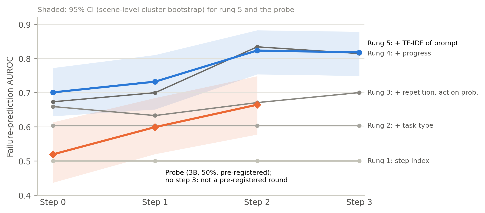
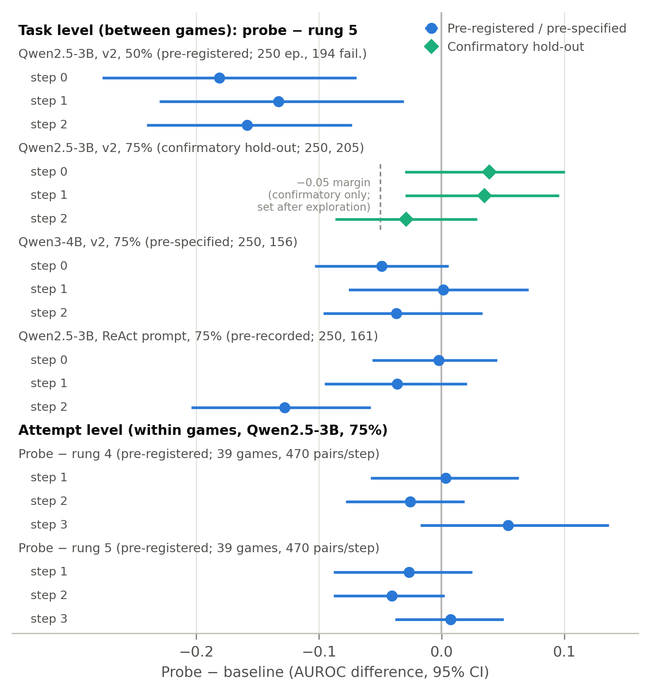
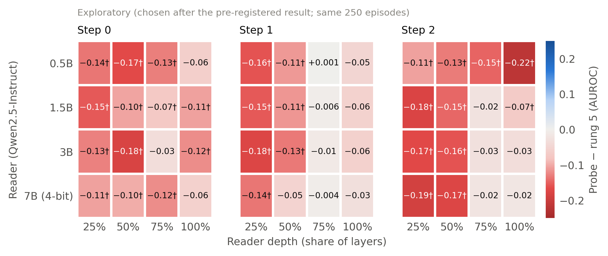
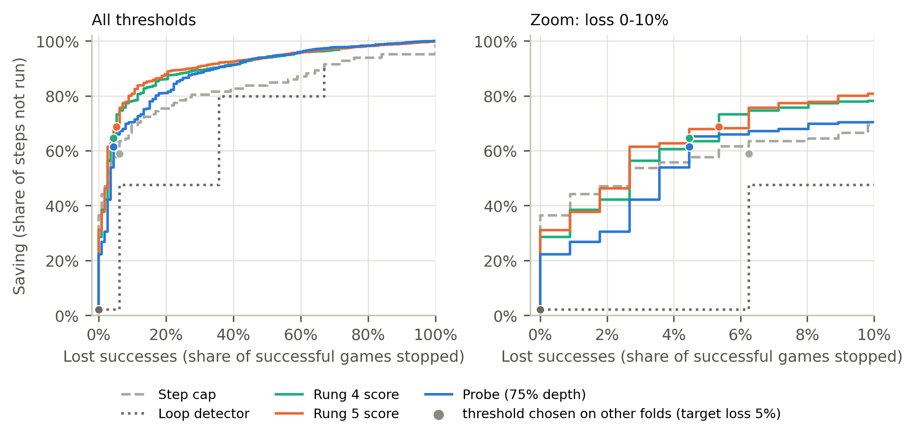

# Failure Prediction in Small Qwen Language-Model Agents: Hidden-State Probes Do Not Beat Visible Information
<!-- Title 2026-10-20, chosen by the author (same in paper/main_en.tex); paired with the Korean noun-ending title. Claims "do not beat" only, not equivalence.
     Superseded: "Failure Prediction in Small Qwen Language-Model Agents: Comparing Hidden-State Probing with Observable Information". Earlier claim-style title:
     Hidden States of Small Qwen Agents Predict ALFWorld Failure No Better Than Visible Task Information Across Games and Attempts. Other alternatives:
     (a) Probing Small Qwen Agents in ALFWorld Finds No Failure Signal Beyond Visible Task Information Between or Within Games
     (b) Do Hidden States Reveal Agent Failure Beyond the Task? A Controlled Test in ALFWorld  [has a question mark; check venue style] -->

<!-- Draft started 2026-10-17; all sections drafted by 2026-10-20. Target: main conference or journal paper; venue TBD. Plan: docs/paper_revision_plan_2026-10-17.md.
     Numbers come from results/*.csv and the plan documents named in each section. Figures 2–4: figures/fig{2,3,4}_*.pdf, drawn from results/*.csv by scripts/2026-10-20/make_figures.py (no Fig. 1 is referenced yet).
     Prior-work numbers checked against the PDFs on 2026-10-20 (docs/citation_check_2026-10-20.md). Before submission: check for reviewed versions of 2026 preprints, format references for the venue. -->

## Abstract
Linear probes on the hidden states of language-model agents have been proposed as cheap monitors that predict failure early, but their gains have been measured against baselines that do not see the task.
We tested whether such probes predict failure beyond the information visible in the prompt for a 3-billion-parameter Qwen2.5 agent in the ALFWorld household text environment.
We evaluated between games on 500 greedy episodes and within games on 100 games run eight times each, compared the probe with a ladder of baselines built from the task type, the prompt text and progress features,
split all data by room layout, and fixed the primary analysis before running it once.
In the pre-registered comparison (probe at 50% depth) the probe was below the full baseline at the first three actions by 0.13 to 0.18 in area under the receiver operating characteristic curve (all 95% confidence intervals below zero; the second action only narrowly after a rough correction for interval coverage),
and on 250 held-out games no action was superior (differences from −0.029 to +0.039, all intervals including zero).
In this sample, whose games were stratified by greedy outcome, the game explained 69.5% of the outcome variance (95% confidence interval 61.3–76.5%). Within games, the probe and the baselines all separated failed from successful attempts above chance from the third action,
but the probe was superior in none of six comparisons. With a four-billion-parameter Qwen3 agent and with an external prompt the probe was again superior at no action, and under the external prompt it was below the baseline at the third action (difference −0.128, 95% confidence interval −0.204 to −0.058).
Used to stop failing episodes with at most 10% of successes lost (the pre-specified range), the probe was not shown to save more actions than a fixed limit (difference −0.032, 95% confidence interval −0.183 to +0.119).
At the best exploratory depth the differences on the same games were −0.034 to −0.011, and +0.006 (−0.024 to +0.037) on all 500 games with about 400 training episodes; because this depth was chosen on the first 250 games, these values favor the probe, and the only value free of that selection is the held-out half (+0.015). In this setting we found no gain from hidden states over visible information, and for the one configuration tested on held-out games (75% depth) the single hold-out's intervals exclude gains above about 0.10 AUROC, although smaller gains cannot be ruled out; claims of hidden-state failure signals in agents should be tested against baselines that see the task and within tasks.

## 1 Introduction
<!-- 2026-10-20 draft from a separate writing session (citations checked against arXiv HTML for [1]-[10], [12], [13]); merged here with: [11] first lowered to "cited by [10]", then cited directly after its abstract was checked (2026-10-20),
     denominators made explicit (22.4% = 56/250 first 250 games; 89.7% = 5,820/6,490 steps of the first 250 games, recomputed from data/main_3b),
     results paragraph checked against Table 4 and extended with the early-termination result. Monitor-cost numbers (13–16%, 2.4x) use Qwen2.5 public parameter counts (0.49B/3.09B; non-embedding 0.36B/2.77B) and the 2N FLOPs/token approximation; state this in the Method. -->

Language-model agents interact with an environment over many steps, and an episode that ends in failure consumes as much computation as one that succeeds. The cost matters most where agents run locally.
On consumer devices, agentic execution raises power draw, temperature and battery drain well above single-inference use, and a substantial amount of this energy is spent on runs that do not succeed [1].
In our setting, a Qwen2.5-3B agent solved 22.4% of the first 250 ALFWorld games (56/250; Wilson 95% CI 17.7–28.0%), and failed episodes accounted for 89.7% of the executed steps in these games.
Stopping doomed episodes early could recover much of this cost. For a small agent, however, the monitor itself has to be cheap. A 0.6B text monitor adds only 0.1–0.6% compute to the three open-weight 9–31B policies in Fail-Fast [2].
Per token, that monitor is 15–52 times cheaper than those policies. A separate 0.5B monitor that reads every token a 3B actor reads would instead add about 13–16% of the actor's compute, and a 7B monitor would cost about 2.4 times as much as the actor.
A probe on the hidden states that the actor already computes needs no additional model call, which makes it a natural candidate for small agents, provided that it really predicts failure.

Predicting failure from internal representations began at the level of questions. Language models can predict whether they know the answer to a question [4]. The entropy over the meanings of sampled answers predicts accuracy [5],
and linear probes approximate that entropy from the hidden state of a single generation [6] or from the question alone, before any token is generated [7]. Ruan et al. [3] extended probing to multi-step agents.
They trained a linear probe on the hidden state at the last token of an action and reported that it predicts eventual failure from the first rounds (round-1 AUC 0.86 and 0.81 on TextCraft with two of three models)
and is consistently stronger than a scorer built from behavioral features. In parallel, early-termination systems based on token log-probabilities [1], a small text monitor [2], and behavioral and textual features [8] have been proposed.

These reports leave one question open: does the signal show how the current attempt is going, or does it show which task the agent faces? Four limitations prevent an answer.

First, outcomes are largely determined by the task. In ten repeated runs of Llama-3.1-70B on HotpotQA, 64 of 100 questions were answered correctly in every run and 23 in none, and linear probes could not predict per-run correctness (AUC 0.34–0.56) [9].
In our data, the game explains 69.5% of the outcome variance (95% CI 61.3–76.5%; the games were stratified by greedy outcome, so this is not a population value). A pooled AUROC can then reflect which task it is rather than how the attempt is going.
Bulut [10] showed that the pooled AUROC is a weighted sum of a within-task and a between-task component, and that a predictor depending on the task alone scores exactly 0.5 within a task.
Reconstructing the closest published early-window probe on public MATH generations, he obtained a pooled AUROC of 0.849 but only 0.496 (95% CI 0.466–0.527) within problem, and a pre-registered difficulty-controlled test found no gain.
Activations taken before generation have also been reported to encode a model-specific notion of difficulty [11]. Ruan et al. collected 4–8 rollouts per task but report no within-task evaluation or difficulty control.

Second, the comparison baselines are weak. The behavioral scorer in [3] uses only action log-probabilities, token counts, prefix length and error keywords; it has no access to the task statement, the observations or the progress made.
In our data, the task type alone gives an AUROC of 0.603 before the first action. In another study, the similarity of observed text predicted behavioral variability better than the similarity of hidden states (r = −0.63 versus −0.35) [9].

Third, the within-task control of [10] does not carry over to interactive agents. Rollouts of the same game in a discrete-action environment share identical prompts early on, which produces tied pairs (52–70% of our evaluation pairs)
and caps the attainable AUROC. In our data, bootstrap intervals also proved narrower than their nominal level (80–94% coverage against 95%). The analysis in [10] covers single-generation math reasoning and does not address these issues.

Fourth, the cost argument for monitors assumes a large policy. The 0.1–0.6% overhead in [2] holds for 9–31B policies, and the assumption fails for the 3B-class agents that run on consumer devices.

**The core problem is therefore that existing evidence cannot tell whether hidden-state failure signals in agents read in-progress failure or task difficulty and visible information. As a result, it is unknown whether the cheapest monitor available to a small agent is useful.**

The distinction decides what to deploy. If a probe reads only difficulty, a classifier on the task text is enough and no access to model internals is needed. If it reads in-progress failure within a task, it offers a gain that visible information cannot provide.
The same distinction also determines whether the probe supports early stopping.

We therefore evaluate hidden-state failure prediction in a small ALFWorld agent [12] under controls that address each limitation. Each limitation is matched with a required function and a design component:

1. *Separate difficulty from in-progress failure.* We evaluate at two levels: a task level (greedy decoding, 500 games) and an attempt level (100 games × 8 rollouts at temperature 1, scored by within-game pairwise AUROC), together with a difficulty oracle that scores exactly 0.5 within a game.
2. *Measure the gain over visible information.* We compare against a five-rung baseline ladder (step index; + task type; + repetition and chosen-action probability; + progress; + TF-IDF of the prompt), plus time-matched variants that drop information from the current step.
3. *Prevent leakage between games.* Games in ALFWorld share room layouts, so we cross-fit and bootstrap by scene. Splitting by game inflated AUROC to 0.97 for a synthetic feature that contained only scene information; with the real probe and rung 5 the change was small (−0.006 and −0.027).
4. *Make the within-task statistics valid for agents.* We report the share of tied pairs and the AUROC ceiling it implies, add a secondary analysis restricted to non-tied pairs, and check the coverage of the intervals with permuted labels.
5. *Prevent selection after seeing results.* The primary analysis and decision rules were registered and run once, and a setting chosen after exploration was confirmed on 250 new games.
6. *Fit a small-agent setting.* The probe reads the 3B actor's own hidden state at no additional model call, actions are chosen by candidate scoring, and we vary the actor (Qwen3-4B), the prompt (the original ReAct examples [13]) and, in an exploratory analysis, the size of the reader that reads the actor's trajectory (0.5B–7B).

Our primary hypothesis, registered before any probe was fit, is H1: on the 3B actor's trajectories read by the 3B model, a linear probe predicts failure at the first three actions better than the full five-rung baseline (the 95% CI of the AUROC difference lies above zero).

We did not reuse existing methods unchanged, for three reasons. The protocol of [3] controls neither difficulty nor visible information and splits by task, which leaks scene information in ALFWorld.
The within-problem evaluation of [10] assumes independent single generations, so it cannot handle shared prefixes in sequential environments. The text monitors of [2] and [1] assume a policy large enough that the monitor's cost is negligible.
Small models also often produce actions that are not in the admissible list when they generate freely, so we choose actions by the log-probability of each admissible candidate and reuse the prompt's key–value cache, which lets the agent run on a single 12 GB GPU.

Under these controls, the probe did not outperform the visible-information baseline. In the pre-registered task-level comparison, the probe scored below the five-rung baseline (differences −0.181, −0.133 and −0.159 at steps 0–2; all 95% CIs below zero).
In a confirmatory hold-out, no step was superior (+0.039, +0.035, −0.029; all CIs include zero). Within a game, both the probe and the baselines predicted failure better than chance from step 2 (probe AUROC 0.585 and 0.619 at steps 2 and 3),
but the probe was superior in none of six comparisons. The same pattern appeared with another actor (Qwen3-4B, superior in 0/3 comparisons) and another prompt (ReAct, 0/3; inferior at step 2).
Used to stop doomed episodes, the probe was not shown to save more steps than a fixed step cap at up to 10% lost successes (difference −0.032, 95% CI −0.183 to +0.119).
These results do not show that the probe and the baseline are equivalent: the intervals are wide (about ±0.06–0.10 at the task level), and we tested one environment and two prompts.

Our contributions are as follows.

- We re-examine hidden-state failure prediction for multi-step agents under difficulty control and within-task evaluation, and find no evidence that the probe beats visible information in this setting.
- We provide pre-registered comparisons of a hidden-state probe against a baseline ladder of visible information, using the same splits and statistics throughout.
- We quantify two problems that arise when within-task evaluation is applied to discrete-action agents: tied pairs from shared prefixes, and bootstrap intervals that are narrower than nominal.
- We compare readers of different sizes on identical trajectories by separating the actor from the reader. This part is exploratory, and no monotone trend with size was observed.

## 2 Related Work
<!-- 2026-10-20 draft from a separate writing session (statements checked against arXiv HTML for [1]-[10], [14], [15]; [11] abstract checked later). Merged with:
     reference numbers aligned ([14] Khan & Khan, [15] Pan et al., [16] = 2604.03754 cited in Section 5);
     2.3 "none used hidden states" lowered to "read observable signals" because the internal-signal baselines of [15] could not be typed;
     absence statements ("[3] reports no within-task evaluation", "no within-instance analysis in [2]") rest on full-text search, not on author confirmation;
     [14] "no measured inference overhead": confirmed by its abstract ("zero measured inference overhead"); [11] and [16] abstracts checked 2026-10-20. Most cited works are 2026 preprints; check for reviewed versions before submission. -->

We group prior work by what the predictor reads and what it is compared against. We then state which parts of earlier protocols we reuse.

### 2.1 Predicting correctness from internal representations
Work on reading success or failure from a model's own states began at the level of single questions. Kadavath et al. [4] trained a value head to predict P(IK), the probability that the model knows the answer to a question, without reference to any proposed answer.
P(IK) transferred partially across tasks but was poorly calibrated out of distribution. Kuhn et al. [5] measured uncertainty as the entropy over meaning clusters of several sampled answers, which predicted accuracy better than lexical baselines, but it required multiple generations per question.
Kossen et al. [6] removed that cost by training linear probes on the hidden state of a single generation to approximate the semantic entropy; the probes generalized better out of distribution than probes that predict accuracy directly.
Moreno Cencerrado et al. [7] moved the readout before generation: probes on activations taken after the question is read, in models from 7B to 70B parameters, predicted whether the forthcoming answer would be correct, but generalization faltered on mathematical reasoning questions.
Lugoloobi et al. [11] trained linear probes on pre-generation activations to predict policy-specific success on math and coding tasks; the linear probe scored above TF-IDF and above question length in 14 of the 15 settings of their main results table, and the authors concluded that models encode a model-specific notion of difficulty distinct from human difficulty. This line of work rests on evidence that truth-related information is linearly accessible in activations. Burns et al. [18] recovered yes–no knowledge from unlabeled activations by finding a direction whose values are logically consistent across a statement and its negation, and Marks and Tegmark [17] reported linear structure in representations of true and false statements at sufficient scale, with probes that transferred across datasets and directions that were causally implicated in outputs. More recently, Ghasemabadi and Niu [19] decoded hidden states and attention patterns of frozen models of 1.7B–20B parameters to predict the correctness of their own answers, and reported that this outperformed internal baselines and large external judges. In all of these studies the target is defined per question, either as one outcome or as an aggregate over samples.
Such a target is meaningful for question answering, but it does not separate a hard question from a failing attempt.

### 2.2 Hidden-state monitors for agents
Ruan et al. [3] applied probing to multi-step agents. They placed a linear probe on the residual stream at the last token of each action, with one layer fixed per model–environment cell.
Probes were cross-fitted with task-grouped splits and evaluated per round on TextCraft and WebShop (800 episodes per cell, three agents of 1.7B–7B parameters).
They reported that the probe predicts eventual failure from the first rounds and outperforms a scorer built from behavioral features. They then converted the signal into an abort cascade with a recall guarantee.
ALFWorld appears in their work only as a boundary test with Qwen-2.5-7B (477 rollouts; probe AUC 0.815) and Qwen3-1.7B (0.764). Their replay procedure and task-grouped evaluation are close to ours, but their probe reads the last token of the generated action, whereas ours reads the last prompt token before the candidate actions are scored.
Their behavioral scorer, however, uses only action log-probabilities, token counts, prefix length and error keywords. Their study reports no within-task evaluation or difficulty control, even though it collected 4–8 rollouts per task, and the grouped splits remain in-distribution by their own account.

Other agent studies read hidden states for different targets. Khan and Khan [14] built a probe-based monitor on layer-28 hidden states of Gemma 4 E4B that detects reasoning degradation at no measured inference overhead.
The probe was trained on 35 proxy-labeled examples drawn from the task bank later used for evaluation, and the authors present the work as a feasibility study. Their small-model tests (1B–1.5B) showed no improvement.
Mehta and Datta [9] measured the similarity of hidden states across repeated runs at the same step and related it to behavioral stability in ReAct agents (r = −0.35 at step 4 on Llama-3.1-70B).
They reported that shared retrieved evidence explains much of the association, that observation text predicts behavior better, and that the measure indexes stability rather than correctness. Linear probes in the same study could not predict per-run correctness.

### 2.3 Early termination without internal states
A second line of work stops likely failures from observable signals. AgentStop [1] trains gradient-boosted trees on token log-probability features and measures energy on a consumer laptop.
It reduced wasted energy by 15–20% for Qwen3-30B-A3B with less than a 5% utility drop. In the 1.7B model, however, log-probabilities of failed and successful runs overlapped more.
Fail-Fast [2] fine-tunes a 0.6B model on text prefixes of SWE-bench Verified trajectories. At a 5% false-positive budget it saved 20.4% of tokens for Qwen3.6-27B, against 12.5% for an AgentStop adaptation and 11.4% for a control that uses the step count alone.
During training it pairs successful and failed prefixes matched by progress to control for instance difficulty. Its evaluation, however, pools 100 held-out instances × 5 runs, and we found no within-instance analysis.
EarlyEval [8] applies the same idea to evaluation cost, halting benchmark runs with classifiers over behavioral, textual and reference-solution features (13–26% fewer steps).
Pan et al. [15] showed that observable macro and micro trajectory features are competitive with internal-signal baselines for web agents, with task-grouped cross-validation. Dubey [20] detected agent failures from observable step telemetry (embeddings of step output, token-level uncertainty and action metadata) with monitors trained only on healthy runs.
These monitors read observable signals (log-probabilities, text and behavior), and all of their evaluations are pooled over tasks. Their monitors are cheap only relative to large policies: the 0.1–0.6% overhead in [2] holds for three open-weight 9–31B policies.

### 2.4 Task difficulty as a confound
The strongest argument that pooled scores can mislead comes from Bulut [10]. He showed that a pooled AUROC is a weighted sum of a within-problem and a between-problem component, and that any predictor that depends on the problem alone scores exactly 0.5 within a problem.
A trace-blind difficulty proxy reached AUROC 0.873 on 192K public R1 generations. A reconstruction of the closest published early-window probe scored 0.849 pooled but 0.496 (95% CI 0.466–0.527) within problem, and a pre-registered test found no gain over a difficulty baseline.
Mehta and Datta [9] reached a similar conclusion for agents from the other direction: correctness was largely determined by the question (64 of 100 questions always correct, 23 never), and per-run probes failed.
Both studies concern settings in which the same question is answered independently, either as a single generation [10] or as a few ReAct runs [9]. Neither evaluates a hidden-state failure probe for an agent that acts in an environment.

### 2.5 Positioning
We reuse from [3] the teacher-forced replay, the per-round evaluation, and the grouping of splits. From [10] we take the within-problem pairwise AUROC and the use of a baseline that depends on the task alone. From [2] we take the control that uses the step count alone.
We add what these works lack for small interactive agents: a five-rung baseline ladder that gradually adds visible information, evaluation at two levels (across games and within a game), scene-level grouping,
handling of tied pairs and of interval coverage in discrete-action environments, and a comparison of a probe on the actor's own hidden state against monitors whose cost is counted relative to a 3B actor.

## 3 Method

### 3.1 Environment and agent
We used ALFWorld (TextWorld version, `alfworld` 0.4.2) with the 3,553 games of the training split and all six task types.
An episode ended when the task was completed or after 30 actions; episodes that did not complete the task were labeled as failures (label 1).
Because ALFWorld has no failing terminal state, a failure is a timeout. To check the 30-action limit, we re-ran all 399 greedy failures with a limit of 100 actions under a pre-registered rule:
11 of 399 succeeded between actions 31 and 100 (2.8%, Wilson 95% CI 1.6–4.9%), so the upper bound was below the pre-registered 5% threshold and we kept the 30-action label (sensitivity analyses in Section 4.7).
The agent (actor) was Qwen2.5-3B-Instruct in bfloat16. At each step the prompt contained a fixed system message (rules and one worked example episode),
the task sentence, the last six observation–action pairs, the current observation, the actions that had recently produced no effect, and the list of admissible actions.
We call this prompt v2. It was written by us: an earlier version followed the thought–action format of ReAct [13], and when we switched to candidate scoring we dropped the thought step
and added six rules and one handwritten example episode. None of its text is taken from the ReAct exemplars. A second, external prompt is described in Section 4.4.

The actor selected actions by constrained scoring rather than free generation. Each admissible action *a* (excluding `help`, `inventory` and `look`)
was scored by the summed log-probability of the continuation `Action: a<|im_end|>` given the prompt, computed in one batched pass that reuses the prompt's key–value cache.
In the greedy policy the highest-scoring action was taken. In the sampling policy an action was drawn from softmax(score / *T*) with *T* = 1,
i.e. the model's distribution renormalized over admissible actions; the random generator was seeded by (sample seed, episode index, step), so rollouts are reproducible and resumable.
Free generation was not used because small models frequently produced inadmissible actions in preliminary runs (Appendix Table A5).

### 3.2 Representations: separating the actor from the reader
Hidden states were taken at the last prompt token, immediately before the action is scored, at relative depths of 25, 50, 75 and 100% of the layers
(layers 9, 18, 27 and 36 for the 3B model). To vary model size without changing the trajectories, we passed the actor's stored prompts through *reader* models by teacher forcing:
Qwen2.5-0.5B-, 1.5B- and 3B-Instruct in bfloat16, and Qwen2.5-7B-Instruct with 4-bit NF4 weights (bfloat16 compute), the largest that fits in 12 GB of GPU memory.
All four models share the tokenizer and chat template; the re-tokenized prompt length matched the stored length at every step, and on the steps we checked (five) the 3B reader reproduced the actor's stored hidden states exactly.
Because readers other than 3B read another model's trajectories, results for them concern external monitoring, not self-monitoring. Because a hidden state at the last prompt token is a deterministic function of the prompt, the question is not whether it holds information absent from the prompt but whether the model's computation makes failure-relevant features linearly readable beyond what the visible-information baselines extract.

### 3.3 Data
**Task-level data (greedy).** We collected 500 greedy episodes on distinct games in the environment's deterministic order.
The first 250 episodes were used for the pre-registered and exploratory analyses; episodes 250–499 were collected afterwards as a confirmatory hold-out
for a single comparison fixed before collection (Section 3.6). Reader hidden states were extracted for the first 250 episodes.

**Attempt-level data (sampling).** Under greedy decoding the outcome is a function of the game, so task-level labels cannot separate task difficulty from in-progress failure.
We therefore re-ran 100 games eight times each with the sampling policy: a pilot of 20 games (10 games the greedy policy solved, 10 it failed; sample seed 0)
and a main set of 80 new games (40 solved, 40 failed by the greedy policy, drawn at random with seed 1 from the remaining greedy games; sample seed 1).
Stratifying by the greedy outcome was decided after the pilot and is reported as a selection step. In total 800 rollouts were used. The 100 games were drawn from the 500 greedy games and can overlap with the first 250; at the attempt level the probe and the baselines were cross-fitted by scene on the sampled rollouts only.
Re-collecting the first 24 main-set rollouts on a fresh installation reproduced them exactly (actions, outcomes and hidden states).

**Additional greedy data (training-size sweep).** For the training-size sweep in Section 4.8 we collected 1,000 further greedy episodes on 1,000 new games (drawn without replacement from the 3,053 training games not among the first 500, seed 0, no stratification), with the same actor, prompt and decoding. The sweep uses these together with the first 500 (1,500 episodes, steps 0–2).

### 3.4 Evaluation units
**Task level (between games).** For each round *r* we kept one row per episode still running at step *r* and computed the AUROC for predicting failure.
Within a round the step index is constant, which removes episode length as a predictor. The pre-registered rounds 1–3 are steps 0–2 (the first three actions);
every episode was still running at these steps.

**Attempt level (within games).** All rollouts of a game share the step-0 prompt, so step 0 was excluded and steps 1–3 were evaluated.
Only games with at least one success and one failure among their eight rollouts contribute. The metric is the within-game pairwise AUROC:
over all (failed, successful) rollout pairs from the same game, the fraction in which the failed rollout received the higher failure score (ties count one half),
pooled across games with weights proportional to the number of pairs.

Two properties of this design were checked before the attempt-level results were read. First, sampled rollouts of a game often had not diverged yet:
of the 470 evaluation pairs per step (39 games with both outcomes, 28 scenes), 70.4%, 66.4% and 52.3% had identical prompts at steps 1, 2 and 3.
The probe input is then identical, so these pairs are ties and cap the probe's pairwise AUROC at 0.648, 0.668 and 0.739.
Second, rungs 3–5 include the repetition count and the probability of the action sampled at the current step, which lie after the probe's input in time
and are exactly where rollouts diverge. We therefore pre-specified two secondary analyses: (i) the same metric restricted to pairs whose prompts differ,
and (ii) time-aligned rungs 4t and 5t in which those two features are taken from the previous step. Secondary results are reported after, and do not replace, the primary result.

### 3.5 Predictors
**Probe.** Standardization followed by L2-regularized logistic regression with balanced class weights.
The regularization strength *C* ∈ {10⁻⁴, 10⁻³, 10⁻², 10⁻¹, 1} was selected in a nested three-fold cross-validation inside each training fold.
A one-hidden-layer MLP (64 units, α = 10⁻², early stopping, fixed hyperparameters) was evaluated as an exploratory probe.

**Baseline ladder.** Each rung adds information available without hidden states:
(1) step index; (2) + task type; (3) + recent repetition count, probability of the chosen action and number of candidates;
(4) + progress features computed from earlier actions (distinct locations visited, open/take/transform/move counts, whether the target object has been seen);
(5) + TF-IDF (word 1–2-grams) of the full user message, which contains the task sentence, room description, recent history, current observation and admissible actions.
Rung 3 uses quantities computed after scoring the current step, slightly later than the probe's input; this favors the baseline.
The probe is compared with rung 5 (pre-registered) and, at the attempt level, with rungs 4 and 5.

**Difficulty oracle (attempt-level analysis).** Each game's greedy outcome from the task-level data, which is independent of the sampled rollouts.
It is constant within a game, so its within-game AUROC is 0.5 by construction (verified as an implementation check).
We also report the share of outcome variance explained by the game (η²) and, on rows pooled across games, the AUROC gain of a logistic stack of [oracle, predictor] over the oracle alone.

### 3.6 Cross-fitting, statistics and pre-registration
All predictors were cross-fitted with five-fold stratified group splits by **scene** (the ALFWorld floor plan; 86 scenes in the first 250 games),
repeated with two seeds and averaged, so that every row is scored by a model that never saw its scene. Splitting by game instead inflated AUROC to 0.97
on a synthetic feature that encodes only the scene. Standardization, TF-IDF and model selection were fit inside each training fold.

Task-level 95% confidence intervals use a scene-level cluster bootstrap (1,000 resamples); differences between a probe and a baseline are computed on the same resamples.
The null distribution re-runs the full pipeline, including nested selection, on permuted labels (100 permutations).
Attempt-level intervals use a game-level bootstrap (1,000 resamples), and the null permutes labels within games with scores held fixed (1,000 permutations).

Before any probe was fit we fixed the code commit, configuration and primary analysis (3B actor and reader, 50% depth, linear probe, rounds 1–3, comparison with rung 5),
and ran it once. The 50% depth was fixed in the plan without a recorded rationale, and the plan did not state whether H1 required all three rounds or any of them; all three differences fell below zero, so the verdict does not depend on that rule. Every later analysis on the same episodes is labeled exploratory. A single exploratory configuration (75% depth, linear) was then tested on the confirmatory
hold-out, training on all 500 episodes and evaluating only episodes 250–499. The decision rule was: superior if the lower 95% bound of the difference exceeds 0,
non-inferior if it exceeds −0.05, inferior if the upper bound is below 0, otherwise inconclusive. The margin of 0.05 was chosen after the exploratory analysis.
The attempt-level analysis (75% depth, linear, vs. rungs 4 and 5, steps 1–3) and its interpretation table (Appendix Table A7) were fixed before the sampled rollouts were collected.
All changes to the frozen procedures are logged with dates in the repository.
Interim counts of the 100-action re-run were seen twice before its decision (at most 3 late successes among the first 116 games); the decision rule had been committed beforehand and was not changed. Appendix Table A8 lists all deviations from the registered plans and all exposures to results before a decision.

### 3.7 Compute
One NVIDIA RTX 4070 (12 GB) under WSL2 (Ubuntu 22.04), Python 3.11, PyTorch 2.11 (CUDA 12.8), Transformers 5.19.0.
Collecting one episode took about 8–11 s; the 640 main-set rollouts took 88 min.

**Monitor cost.** Following [2], we approximate inference compute as 2*N* floating-point operations per token for a model with *N* parameters, so the extra cost of a separate monitor that reads the same tokens is its parameter count relative to the actor's. This assumes that the monitor reads every token the actor reads. [2] reports a lower overall overhead (0.1–0.6%) than its per-token ratio, so its figure also depends on how many tokens its monitor reads.
With the public Qwen2.5 counts (0.5B: 0.49B total, 0.36B without embeddings; 3B: 3.09B and 2.77B; 7B: 7.61B and 6.53B), a 0.5B monitor adds 0.36/2.77 ≈ 13% to 0.49/3.09 ≈ 16% to a 3B actor,
and a 7B monitor costs 6.53/2.77 ≈ 2.36 to 7.61/3.09 ≈ 2.46 times as much as the actor (about 2.4 times). A probe on the actor's own hidden state adds one dot product with a 2,048-dimensional vector per step and needs no additional model call.
We did not measure energy or latency.

## 4 Results
### 4.1 Task level
**Data.** The greedy actor completed 56 of the first 250 episodes (22.4%, Wilson 95% CI 17.7–28.0%) and 101 of all 500.
The 250 games covered 86 scenes. Successful episodes took 4–28 actions (median 12), so all 250 episodes were still running at steps 0–3,
and the failure rate in every pre-registered round was 0.776.

**Baselines.** Information visible without hidden states already predicted failure before the first action (Table 1, Fig. 2).
Task type alone gave an AUROC of 0.603, and the full rung-5 baseline reached 0.701 at step 0, 0.732 at step 1 and 0.823 at step 2.
Progress features (rung 4) accounted for most of the rise from step 2 onward (0.673 → 0.834); at steps 2 and 3, rung 5 was not higher than rung 4.
The step-index rung was exactly 0.500 in every round, as intended. Permuted-label AUROCs averaged 0.50 (95% range about 0.38–0.62).

**Pre-registered comparison.** In the single pre-registered run (3B reader, 50% depth, linear probe), the probe scored below the rung-5 baseline in all three rounds,
and every 95% interval of the difference lay below zero (Table 1, Fig. 3): −0.181 (−0.276 to −0.069) at step 0, −0.133 (−0.230 to −0.031) at step 1 and
−0.159 (−0.240 to −0.073) at step 2. Hypothesis H1 was therefore not supported in the pre-registered cell; this matches the third outcome of the interpretation table fixed in advance (Appendix Table A7)
("even the 3B reader does not beat rung 5").

**Exploratory analyses (same 250 episodes).** We then evaluated all 96 combinations of four readers, four depths, two probe types and three rounds (linear cells in Fig. 4; all cells in Appendix Table A9).
No combination exceeded the baseline by more than 0.004, and the two positive differences (+0.004 and +0.001) had intervals spanning zero.
The 75% depth was the best or near-best depth for every reader; for the 3B reader the linear probe at 75% depth was within −0.034 to −0.011 of the baseline (all intervals include zero).
Averaged over steps 0–2, the best-depth linear AUROC was 0.660 (0.5B), 0.717 (1.5B), 0.727 (3B) and 0.717 (7B, 4-bit; best depth 100%), i.e. no monotonic increase with reader size;
the 7B result is confounded with quantization. Averaged over depths, the fixed MLP was not better than the linear probe (differences −0.035 to −0.004).
Of 36 pairwise reader comparisons, 4 had intervals excluding zero, close to the about 2 expected by chance, and their signs were inconsistent.
These analyses were chosen after seeing the pre-registered result and are not evidence on their own.

**Confirmatory hold-out.** The one configuration carried forward (3B reader, 75% depth, linear) was evaluated on the 250 new episodes
(205 failures, failure rate 0.82; Table 2). The differences from rung 5 were +0.039 (−0.030 to +0.100), +0.035 (−0.030 to +0.096) and −0.029 (−0.087 to +0.029) at steps 0–2.
No round met the criterion for superiority and none was inferior; steps 0 and 1 met the non-inferiority rule, whose margin was set after exploration, and step 2 was inconclusive.
The rung-5 baseline was lower on the hold-out than on the first 250 episodes (0.607 vs. 0.701 at step 0), which indicates sample-to-sample variation of this size.

| Table 1 (draft). Failure prediction AUROC on the first 250 episodes (pre-registered rounds: steps 0–2). | step 0 | step 1 | step 2 | step 3 (baselines only) |
|---|---|---|---|---|
| Rung 1: step index | 0.500 | 0.500 | 0.500 | 0.500 |
| Rung 2: + task type | 0.603 | 0.603 | 0.603 | 0.603 |
| Rung 3: + repetition, chosen-action probability | 0.659 | 0.633 | 0.671 | 0.700 |
| Rung 4: + progress | 0.673 | 0.700 | 0.834 | 0.814 |
| Rung 5: + TF-IDF of prompt | 0.701 | 0.732 | 0.823 | 0.818 |
| Probe, 3B reader, 50% depth (pre-registered) | 0.520 | 0.599 | 0.665 | – |
| Probe − rung 5 (95% CI) | −0.181 (−0.276, −0.069) | −0.133 (−0.230, −0.031) | −0.159 (−0.240, −0.073) | – |

*n* = 250 episodes (194 failures) per round; CIs from a scene-level cluster bootstrap (1,000 resamples). Interval half-widths for single AUROCs were about 0.07–0.09. Step 3 is not a pre-registered round; the probe was not evaluated there. <!-- Sources: `results/probe_main_3b_primary*.csv`, `results/baselines_main_3b.csv` -->

| Table 2 (draft). Confirmatory hold-out (episodes 250–499; 3B reader, 75% depth, linear). | step 0 | step 1 | step 2 |
|---|---|---|---|
| Probe AUROC (95% CI) | 0.645 (0.547, 0.736) | 0.716 (0.619, 0.810) | 0.729 (0.633, 0.815) |
| Rung 5 AUROC | 0.607 | 0.681 | 0.758 |
| Probe − rung 5 (95% CI) | +0.039 (−0.030, +0.100) | +0.035 (−0.030, +0.096) | −0.029 (−0.087, +0.029) |
| Decision (margin 0.05, set post hoc) | non-inferior | non-inferior | inconclusive |

*n* = 250 episodes (205 failures). Training used all 500 episodes; evaluation used only the new 250. Margin sensitivity, read from the same intervals (lower bounds −0.030, −0.030, −0.087; upper bounds all above zero): with a margin of 0.025 no step would be non-inferior, and with 0.10 all three would be. Because the margin was set post hoc, the differences and intervals, not the labels, carry the evidence.

*Fig. 2. Failure-prediction AUROC of the baseline ladder (steps 0–3) and the pre-registered probe (steps 0–2) on the first 250 episodes (n = 250, 194 failures per step). Rung 5 and the probe are emphasized, with shaded 95% CIs from a scene-level cluster bootstrap (1,000 resamples); CIs of rungs 1–4 are omitted for legibility. Rung 1 is 0.5 by design and rung 2 does not change with the step. Overlap of the two shaded bands is not a test of their difference; the paired differences are in Fig. 3.* <!-- Sources: `results/baselines_main_3b.csv`, `results/probe_main_3b_primary.csv` -->

*Fig. 3. All pre-registered, pre-specified and confirmatory probe-versus-baseline comparisons (18; none superior). The comparisons share games and baselines and are not independent, so their count is not a pooled estimate. Points are AUROC differences with 95% CIs. Task level: probe − rung 5, scene-level cluster bootstrap (1,000 resamples); labels give the setting and n (episodes, failures). Attempt level: within-game pairwise AUROC differences, game-level bootstrap (1,000 resamples); on label-shuffled data these intervals covered the null value only 80–94% of the time (Section 4.2), so they are too narrow. Dashed segment: −0.05 non-inferiority margin, applied only to the confirmatory hold-out and set after the exploratory analysis. Exploratory estimates are not shown (Fig. 4).* <!-- Sources: `results/probe_main_3b_primary_diff.csv`, `confirm_main_3b_diff.csv`, `task_qwen3_4b_diff_p.csv`, `task_react_qwen25_3b_diff_p.csv`, `within_game_diff.csv` -->

*Fig. 4. Exploratory: probe − rung 5 AUROC difference for every reader × depth of the linear probe on the first 250 episodes (48 cells, no selection). Diverging color centered on zero (red: probe below rung 5); † marks cells whose 95% CI (scene-level cluster bootstrap) excludes zero, all of them below zero (31 of 48). No cell's CI lies above zero; the largest difference is +0.001. The 7B reader used 4-bit weights, so size is confounded with quantization. Linear and MLP cells with CIs: Appendix Table A9.* <!-- Source: `results/explore_{0.5B,1.5B,3B,7B-4bit}_diff.csv` -->
### 4.2 Attempt level
**Primary result.** Within games, the probe's pairwise AUROC was 0.520 (95% CI 0.453–0.583) at step 1, 0.585 (0.522–0.654) at step 2 and 0.619 (0.552–0.687) at step 3 (Table 3, Fig. 3).
Rungs 4 and 5 reached 0.517 and 0.547, 0.611 and 0.626, and 0.565 and 0.612. From step 2 on, all three methods separated failed from successful attempts of the same game above chance
(within-game permutation p ≤ 0.018), whereas at step 1 only rung 5 did (p = 0.016). These verdicts rest on the permutation test; the 95% bootstrap interval of rung 4 at step 3 (0.492–0.644) includes 0.5. None of the six probe–baseline differences met the superiority criterion and none was inferior;
the largest difference was +0.054 (−0.017 to +0.136) against rung 4 at step 3. The result fits no row of the interpretation table (Appendix Table A7) cleanly: the probe was not better than the baselines,
and no comparison met the equivalence definition (95% CI within ±0.05). At this sample size the 95% intervals of the six differences were 0.088–0.154 wide. To meet the equivalence band an interval must be narrower than 0.10 and lie within ±0.05 of zero; three intervals met the width condition but none the position, so the absence of an "equivalent" verdict reflects the sample size (Section 6) as well as the data.

**Secondary analyses.** Restricting the evaluation to pairs whose prompts differed (139, 158 and 224 pairs at steps 1–3) raised every method (probe 0.568, 0.753 and 0.750; rung 5 0.633, 0.816 and 0.754),
but none of the six differences was resolved (intervals of about ±0.1–0.2). With the time-aligned rungs 4t and 5t the probe was not better at any step; at step 1 it was lower than both
(−0.045, −0.098 to −0.006; −0.038, −0.084 to −0.004), although not after Holm adjustment (p = 0.18). Neither tied pairs nor the timing asymmetry therefore explains the absence of a probe advantage.
In all 889 tied pairs the probe and the time-aligned rungs gave identical scores, confirming that they use information from the same point in time.

**Calibration of the intervals.** On label-shuffled data (20 seeds), game-level percentile bootstrap intervals contained the null value 80–94% of the time rather than 95%,
and the "equivalent" verdict appeared in 54–65% of null runs. Borderline verdicts above should be read with this in mind.

| Table 3. Within-game pairwise AUROC (T = 1 sampling; 39 games with both outcomes, 470 pairs per step). | step 1 | step 2 | step 3 |
|---|---|---|---|
| Probe (3B, 75% depth, linear) | 0.520 (0.453, 0.583) | 0.585 (0.522, 0.654) | 0.619 (0.552, 0.687) |
| Rung 4 | 0.517 (0.452, 0.582) | 0.611 (0.541, 0.687) | 0.565 (0.492, 0.644) |
| Rung 5 | 0.547 (0.478, 0.618) | 0.626 (0.563, 0.699) | 0.612 (0.546, 0.682) |
| Probe − rung 4 (95% CI) | +0.003 (−0.058, +0.063) | −0.026 (−0.078, +0.019) | +0.054 (−0.017, +0.136) |
| Probe − rung 5 (95% CI) | −0.027 (−0.088, +0.025) | −0.040 (−0.088, +0.002) | +0.007 (−0.038, +0.051) |
| Tied pairs (identical prompts) | 70.4% | 66.4% | 52.3% |

CIs from a game-level bootstrap (1,000 resamples). Rung 2 and the difficulty oracle are constant within a game and scored exactly 0.500 (implementation check).
### 4.3 How much the game determines the outcome
In the sampled data, the game explained η² = 0.695 (95% CI 0.613–0.765) of the outcome variance; because games were stratified by their greedy outcome, this is not a population value.
On rows pooled across games, the difficulty oracle alone reached an AUROC of 0.877. Adding the probe to the oracle changed the pooled AUROC by −0.002 (−0.026 to +0.025), +0.022 (−0.005 to +0.048)
and +0.042 (+0.017 to +0.073) at steps 1–3; adding rung 5 changed it by +0.004 (−0.018 to +0.027), +0.034 (+0.007 to +0.060) and +0.029 (+0.003 to +0.058). These gains are uncorrected secondary measures.
Most of what any method predicts across games is therefore already predicted by knowing the game.
### 4.4 Other actors and a second prompt
Each model and prompt is reported separately; results are not pooled.

**Which actors entered.** Five further models were piloted on the first 20 games under a rule fixed before the pilots
(at least 3 of 20 successes, completion without running out of 12 GB of memory, at most three times the reference time per episode, no non-finite hidden states; Appendix Table A1).
Only Qwen3-4B (thinking disabled) passed, with 7 of 20 successes. Qwen3-1.7B, Llama-3.2-3B-Instruct, SmolLM3-3B and Phi-3.5-mini-instruct each succeeded on 1 of 20 games
(Wilson 95% CI 1–24%) and were excluded; Phi-3.5-mini also exceeded the time criterion. Before the SmolLM3 pilot we changed the rule so that every model passing it would be included,
so that substitutes could not be chosen after seeing results. Once the pre-listed substitutes were used up we added no further models; the model extension therefore covers two Qwen models.
In the excluded models, actions repeated within the last six steps far more often than in the two Qwen models (66–82% vs. 32–51%; exploratory description, Appendix Table A2).
Because v2 was tuned with Qwen2.5, this may reflect prompt–model fit rather than model capability; with 20 games per model we make no claim about differences in success rate.

**Qwen3-4B, task level.** On the same 250 games the greedy Qwen3-4B actor succeeded on 94 (37.6%; Qwen2.5-3B: 56).
The depth (75%) and the comparison with rung 5 were fixed before these data were collected. The probe on the actor's own hidden states did not beat rung 5 in any round
(Table 4): −0.049 (−0.103 to +0.005) at step 0, +0.001 (−0.076 to +0.071) at step 1 and −0.037 (−0.096 to +0.033) at step 2.
No round was superior, also after Holm adjustment across the three rounds, and none was non-inferior or inferior, so all three were inconclusive.
The direction matches Qwen2.5-3B: the probe on the actor's own hidden states shows no advantage over the surface baseline.

**Qwen3-4B, attempt level.** Sampled rollouts of Qwen3-4B rarely diverged: only 10 of 50 games had both outcomes among eight rollouts (Qwen2.5-3B: 39 of 100),
and the chosen action had probability above 0.99 in 77% of steps 1–3. All methods scored 0.47–0.52 within games, with most pairs tied.
We decided before reading these results not to enlarge the sample and to report them only in the appendix (Table A3); the attempt-level question could not be answered for this model.

**A second prompt (ReAct exemplars).** To test whether the conclusion depends on our own prompt, we re-ran Qwen2.5-3B on the same 250 games with the original ALFWorld exemplars of ReAct
[13], changing only the action grammar to that of `alfworld` 0.4.2 (`put A in/on B` → `move A to B`). The two prompts differ in several ways at once (Appendix Table A4):
the ReAct prompt is a raw completion string rather than a chat template, uses two exemplars matched to the current task type instead of one fixed example,
keeps the full history instead of the last six steps, and omits the admissible-action list and the note on failed actions. The policy, games, analysis and decision rule were unchanged,
and the rung-5 text used only the current game, excluding the exemplars. We therefore treat this prompt as a check on the conclusion, not as an estimate of any single prompt factor.

The pre-recorded comparison (75% depth, linear, vs. rung 5; 89 successes) gave −0.002 (−0.057 to +0.045) at step 0, −0.036 (−0.096 to +0.021) at step 1 and −0.128 (−0.204 to −0.058) at step 2 (Table 4).
No round was superior (also after Holm adjustment); steps 0 and 1 were inconclusive and step 2 was inferior. As specified in advance, this shows no evidence that the probe beats the surface baseline
under an external prompt either. We do not compare the size of the gap between prompts, which was not tested and is affected by their different failure rates (0.776 vs. 0.644).
At 50% depth (secondary) the differences were −0.036, −0.032 and −0.048, all inconclusive. Under this setting the ReAct-format prompt succeeded more often than v2
(89 vs. 56 of 250; paired difference +0.132, 95% CI 0.060–0.204; exact McNemar p = 0.0006); because several factors changed together, we do not attribute this to any one of them.

In an exploratory check, a probe trained on v2 trajectories and applied to ReAct trajectories (scenes of the test games excluded from training) reached 0.527, 0.493 and 0.555 at steps 0–2,
below the probe trained within ReAct (0.659, 0.623 and 0.593; differences at steps 0 and 1 with intervals below zero). Re-standardizing the ReAct states without labels did not help (0.550, 0.482, 0.586).
This suggests that the direction the probe learns is tied to the prompt format; because the two prompts also extract hidden states at different tokens, we cannot separate a different signal from a shifted representation.

**Summary across settings.** In the four task-level evaluations (pre-registered, confirmatory, Qwen3-4B, ReAct prompt), the probe was superior to rung 5 in 0 of 12 rounds (Fig. 3).

| Table 4. Task-level probe − rung 5 (AUROC difference, 95% CI) across settings | step 0 | step 1 | step 2 |
|---|---|---|---|
| Qwen2.5-3B, v2, 50% depth (pre-registered; *n* = 250, 194 failures) | −0.181 (−0.276, −0.069) | −0.133 (−0.230, −0.031) | −0.159 (−0.240, −0.073) |
| Qwen2.5-3B, v2, 75% depth (confirmatory hold-out; 250, 205) | +0.039 (−0.030, +0.100) | +0.035 (−0.030, +0.096) | −0.029 (−0.087, +0.029) |
| Qwen3-4B, v2, 75% depth (pre-specified; 250, 156) | −0.049 (−0.103, +0.005) | +0.001 (−0.076, +0.071) | −0.037 (−0.096, +0.033) |
| Qwen2.5-3B, ReAct prompt, 75% depth (pre-recorded; 250, 161) | −0.002 (−0.057, +0.045) | −0.036 (−0.096, +0.021) | −0.128 (−0.204, −0.058) |

Probe and rung-5 AUROCs: Qwen3-4B 0.660/0.687/0.680 vs. 0.709/0.686/0.717; ReAct prompt 0.659/0.623/0.593 vs. 0.661/0.660/0.721. Scene-level cluster bootstrap, 1,000 resamples.
### 4.5 Comparison with prior failure-prediction and uncertainty methods
To relate our results to earlier agent monitors, we approximated two task-blind baselines from the prior work with fields stored at every step (exploratory; plan fixed before the run) <!-- plan: `docs/prior_methods_plan_2026-10-20.md` -->.
The behavioral baseline follows the scorer of [3]: the log-probability, mean token log-probability and token count of the chosen action at the current and previous step, the prompt length, and a count of error phrases in the current observation (always zero under candidate scoring).
The log-probability baseline follows [1]: the entropy of the candidate distribution, the margin between the two best candidates, the probability of the chosen action, the number of candidates, and the mean token log-probability of the chosen action at the current and previous step.
Because actions are scored rather than generated, these are approximations of the original features, not reproductions. Splits, statistics and the probe (75% depth, linear) were the same as in Section 4.1, on the first 250 episodes.

Against these task-blind baselines the probe was clearly better (Table 6): by +0.145 (0.032 to 0.247), +0.167 (0.070 to 0.247) and +0.190 (0.107 to 0.282) over the behavioral baseline at steps 0–2,
and by +0.040 (−0.060 to +0.133), +0.176 (0.051 to 0.297) and +0.189 (0.074 to 0.296) over the log-probability baseline. Adding only the task type to the behavioral features raised its AUROC by 0.08–0.10 (all intervals above zero),
and against the full rung 5 the same probe showed no advantage (−0.034, −0.011, −0.029; all intervals include zero). These exploratory comparisons (15, uncorrected) suggest that a hidden-state advantage over task-blind monitors,
as reported in earlier work, can disappear once the baseline sees the task. We did not test text monitors fine-tuned on trajectories [2]; the text available to them is covered here by the TF-IDF of rung 5.

| Table 6 (exploratory). Task-level AUROC of prior-style baselines, first 250 episodes | step 0 | step 1 | step 2 |
|---|---|---|---|
| Behavioral features (after [3]) | 0.522 | 0.554 | 0.605 |
| Log-probability features (after [1]) | 0.626 | 0.545 | 0.606 |
| Behavioral + task type | 0.626 | 0.656 | 0.689 |
| Rung 5 | 0.701 | 0.732 | 0.823 |
| Probe (75% depth, linear) | 0.666 | 0.721 | 0.795 |
| Probe − behavioral (95% CI) | +0.145 (0.032, 0.247) | +0.167 (0.070, 0.247) | +0.190 (0.107, 0.282) |
| Probe − log-probability (95% CI) | +0.040 (−0.060, 0.133) | +0.176 (0.051, 0.297) | +0.189 (0.074, 0.296) |
| Probe − rung 5 (95% CI) | −0.034 (−0.102, 0.037) | −0.011 (−0.082, 0.061) | −0.029 (−0.091, 0.027) |

*n* = 250 (194 failures) per step; scene-level cluster bootstrap, 1,000 resamples. <!-- Source: `results/prior_methods_3b*.csv` -->
### 4.6 Early termination
To test the practical motivation directly, we evaluated stopping rules on the 500 greedy Qwen2.5-3B games with a 100-action horizon
(the 30-action trajectory for the 101 early successes and the 100-action re-run for the other 399; 112 successes within 100 actions; 40,500 steps). The plan was fixed before the late-success results were read.
Before each action a rule stops the episode if its score is at least a threshold; a stopped episode counts as a failure. Cost is the number of executed actions, since the actor's own hidden state is computed anyway.
For each rule we swept the threshold and measured, for every allowed loss of successes ℓ from 0 to 10% in steps of 0.5 percentage points, the largest fraction of steps saved, and averaged these values.
The rules were a step cap, a loop detector (how often the previous action had occurred in the six steps before it; "Nothing happens" never occurred under candidate scoring),
time-aligned rungs 4t and 5t, and the probe (75% depth plus step index), all learned rules cross-fitted by scene on rows still running at each step.
The single primary comparison was the probe against the better of the two rules without training, with a scene-level cluster bootstrap (1,000 resamples).

The probe saved 0.529 (95% CI 0.382–0.667) of the steps on this measure, the step cap 0.560 (0.468–0.656), the loop detector 0.194 (0.023–0.361),
rung 4t 0.608 (0.477–0.748) and rung 5t 0.625 (0.503–0.758); stopping exactly the failures at step 0 would save 0.958 (Table 5).
The primary difference, probe minus step cap, was −0.032 (−0.183 to +0.119), inconclusive, so a practical gain from self-monitoring was not shown in this setting. This verdict holds for the pre-specified range of up to 10% lost successes; the secondary results below depend on the loss range and on how the threshold is chosen.
In secondary analyses the probe minus rung 5t was −0.096 (−0.219 to +0.011) and minus rung 4t −0.079 (−0.231 to +0.067). Over the whole loss range (0–100%)
the probe was better than the step cap (+0.056, 0.029–0.082) but worse than rung 5t (−0.023, −0.046 to −0.002). With thresholds chosen on other folds for a 5% loss,
the probe saved 0.614 of the steps (test loss 4.5%), the step cap 0.588 (6.3%) and rung 5t 0.686 (5.4%).
These secondary results suggest that where the probe helps over a fixed cap, a surface baseline helps at least as much. Because 10% of the successes is about 11 episodes, the intervals are wide.
Choosing the threshold on the evaluated data slightly favors scores with many distinct values, such as the learned rules (about +0.004 on synthetic data); this favors the probe and does not change the conclusion.

| Table 5. Early termination, Qwen2.5-3B, 500 games, 100-action horizon | Mean max. steps saved at ≤ 10% lost successes (95% CI) | Relative to oracle |
|---|---|---|
| Step cap | 0.560 (0.468, 0.656) | 0.58 |
| Loop detector | 0.194 (0.023, 0.361) | 0.20 |
| Rung 4t | 0.608 (0.477, 0.748) | 0.63 |
| Rung 5t | 0.625 (0.503, 0.758) | 0.65 |
| Probe (75% depth + step) | 0.529 (0.382, 0.667) | 0.55 |
| Oracle (stop failures at step 0) | 0.958 (0.947, 0.969) | 1 |
### 4.7 Robustness checks (summary; details in Appendix)
**Label horizon.** With the 100-action label, the pre-registered comparison stayed inferior at steps 0 and 2 and became inconclusive at step 1 (upper bound +0.005);
the confirmatory comparison again showed no superior round (step 0 changed from non-inferior to inconclusive). Re-running the original analyses with the original labels in the current
software environment reproduced every reported value exactly, so these changes reflect the relabeling of 4 (first 250) and 11 (all 500) episodes only.

**Stronger probes.** To check that the probe did not lose because it was too weak, we compared the reference probe and five stronger variants with rung 5 on the first 250 episodes (exploratory; plan fixed before the run, with hyperparameters selected inside each training fold):
a wider regularization grid (*C* = 10⁻⁶ to 10³), PCA with *k* ∈ {8, 32, 64, 128}, all four depths concatenated (8,192 dimensions), a small MLP grid (32 or 128 hidden units, α = 10⁻³ or 10⁻¹), and rung 5 with the 75% hidden state added as extra features.
None of the 18 comparisons was superior to rung 5 (Table 7). The largest difference was +0.013 (−0.072 to +0.101; wider grid, step 1); the concatenated probe was below rung 5 at step 2 (−0.077, −0.159 to −0.003; Holm-adjusted p = 0.79).
Adding the hidden state to rung 5 did not improve it (−0.034, −0.023, −0.024; all intervals include zero). With about 200 training episodes per fold, adding 2,048 dimensions to rung 5 can also overfit, so this check is weak. The reference probe reproduced its earlier values exactly. These results suggest that the conclusion does not depend on the probe's capacity within this range.

**Later rounds and temporal features.** Beyond the pre-registered first three actions, we compared the 75% linear probe with rung 5 at steps 0–10 on episodes still running (exploratory; 224–250 episodes per step).
The differences ranged from −0.114 to +0.009; none was superior, and one (step 9, −0.114, −0.219 to −0.023) was inferior before correction for the 11 steps. From step 7 on, the progress features of rung 4 use actions older than the six steps shown in the prompt, so at these steps the baselines see information that the probe input does not.
Probes on the running mean of hidden states over earlier steps, alone or together with the current state, were not better than rung 5 at steps 1, 2, 3 or 5 (differences −0.046 to +0.011, all intervals include zero).

**Already reported elsewhere.** Time-aligned baselines and the restriction to non-tied pairs are in Section 4.2, interval calibration on shuffled labels in Section 4.2, and the reproduction of all original analyses in the current environment above.
We did not run a divergence-aligned analysis, cross-validation seed variance beyond two repeats, a scene-level permutation test, or a comparison with a free-generation agent.

| Table 7 (exploratory). Stronger probes − rung 5 (AUROC difference, 95% CI), first 250 episodes | step 0 | step 1 | step 2 |
|---|---|---|---|
| Reference (75% depth, linear, *C* ≤ 1) | −0.034 (−0.102, 0.037) | −0.011 (−0.082, 0.061) | −0.029 (−0.091, 0.027) |
| Wider *C* grid | −0.036 (−0.105, 0.036) | +0.013 (−0.072, 0.101) | −0.034 (−0.099, 0.026) |
| PCA (*k* 8–128) | −0.019 (−0.084, 0.041) | −0.037 (−0.103, 0.032) | −0.029 (−0.091, 0.026) |
| Four depths concatenated | −0.052 (−0.121, 0.008) | −0.055 (−0.127, 0.023) | −0.077 (−0.159, −0.003) |
| MLP (grid of 4) | −0.036 (−0.104, 0.023) | −0.025 (−0.105, 0.058) | −0.052 (−0.122, 0.017) |
| Rung 5 + hidden state | −0.034 (−0.101, 0.037) | −0.023 (−0.096, 0.047) | −0.024 (−0.086, 0.032) |

Rung 5 AUROC 0.701, 0.732, 0.823. *n* = 250 (194 failures) per step; scene-level cluster bootstrap, 1,000 resamples. <!-- Sources: `results/probe_strength_3b*.csv`, `results/extra_main_3b_B_late_rounds.csv`, `results/extra_main_3b_C_temporal.csv` -->

### 4.8 Additional checks (exploratory)
We ran six further checks on the first 250 episodes at steps 0–2 (exploratory; plan fixed before the run, each analysis run once; no hold-out data except in the two training-size sweeps below). Intervals are from the scene-level cluster bootstrap (1,000 resamples), and values are means over the three steps unless stated (Tables 8 and 9). With the full training folds, all four methods (the 75% and 50% probes, rungs 4 and 5) reproduced their earlier values exactly.

| Table 8 (exploratory). Additional checks: question, result and whether the conclusion changes | Question | Result (mean over steps 0–2, 95% CI) | Conclusion changed? |
|---|---|---|---|
| Training-set size | Does the gap to rung 5 close with more training data? | 75% probe − rung 5, first 250: −0.002 (about 50 training episodes) to −0.025 (about 200); all 500 with fixed evaluation folds: +0.016 (about 50) to +0.006 (about 400), change −0.010 (−0.038, 0.022); all 1,500 (500 + 1,000 new) with fixed evaluation folds: +0.016 (about 50), +0.002 (about 400), −0.006 (about 1,200), change from about 400 to about 1,200 −0.008 (−0.017, 0.002); all CIs include zero | No narrowing detected up to about 1,200 episodes (CI of the change −0.017 to +0.002) |
| Low false-positive region | Is the probe better where stopping matters? | Detection at 10% false positives, probe − rung 5: −0.139 (−0.273, 0.075) | No |
| Split unit | Does splitting by game inflate the real methods? | Game − scene split: −0.006 (probe), −0.027 (rung 5) | No |
| Interval coverage | Are task-level intervals too narrow? | Shuffled-label coverage 90.0% (probe), 85.0% (rung 5), 88.3% (difference) | No; pre-registered step 1 only narrowly below zero after widening |
| Reading position | Does the last action token change the result? | 75% action token − rung 5: −0.019 (−0.085, 0.046) | No |
| Text encoder | Is there a stronger text baseline? | bge embedding + rung 4 − rung 5: −0.115 (−0.187, −0.052) | Not answered; this encoder was weaker than TF-IDF |

**Training-set size.** We trained the 75% probe and rung 5 on 25, 50, 75 and 100% of each outer training fold (about 50 to 200 episodes; five draws below 100%). The probe minus rung 5 was −0.002, −0.011, −0.021 and −0.025, all intervals including zero: the point estimates widened rather than narrowed, because rung 5 gained more from the added data (0.684 to 0.752) than the probe (0.681 to 0.727). The confirmatory hold-out, the only result trained on about 400 episodes (all 500 episodes, five folds), went the other way (mean +0.015), but its evaluation set differs (rung 5 at step 0: 0.607 vs. 0.701), so the two cannot be compared. The 50% probe stayed below rung 5 at every size (−0.104 to −0.158; Table 9). To compare sizes on the same evaluation rows, we repeated the sweep on all 500 episodes with the evaluation folds fixed and 12.5 to 100% of each training fold (about 50 to 400 episodes; exploratory, planned after the results above and using the hold-out). The probe minus rung 5 was +0.016, +0.005, +0.011, +0.009 and +0.006, all intervals including zero. Its change from about 50 to about 400 training episodes was −0.010 with a 95% CI of −0.038 to +0.022, so we detected no change, but a narrowing of up to about 0.02 is not ruled out. On the same evaluation rows (the first 250 episodes), training on about 400 episodes of all 500 instead of about 200 of the first 250 moved the difference from −0.025 to −0.003, a change of +0.022 toward narrowing; both values lie well within their intervals. Restricted to the last 250 episodes, the full-size run reproduced the confirmatory values exactly. Both methods were still improving at about 400 training episodes (probe 0.651 to 0.707, rung 5 0.635 to 0.701), so the curves had not levelled off, which motivated the larger sweep below. The 50% probe stayed below rung 5 at every size here as well (−0.042 to −0.057).

**Larger training sets (1,500 episodes).** We collected 1,000 further greedy episodes on new games (none shared with the first 500; same actor, prompt and decoding) as an exception to our rule of not enlarging samples. The sizes, the primary contrast and the interpretation rules were written before collection, and the plan and its change log are in the repository (Appendix Table A8). The sweep was repeated on all 1,500 episodes (steps 0–2, 108 floor plans) with the evaluation folds fixed and 1/24 to all of each outer training fold (about 50 to 1,200 episodes; exploratory; analysis run once, after a first run whose output had not been saved). The 75% probe minus rung 5 was +0.016, +0.002 and −0.006 at about 50, 400 and 1,200 training episodes, all intervals including zero (Table 9). The primary contrast, the gap at about 1,200 minus the gap at about 400, was −0.008 (95% CI −0.017 to +0.002): we detected no narrowing, and the point estimate went the other way. Most of the gain in AUROC came before about 400 episodes (probe 0.652, 0.730, 0.742; rung 5 0.636, 0.728, 0.747 at about 50, 400 and 1,200). The width of the interval of the difference (about 0.037) did not shrink with training size, so it is set by the evaluation rows, not by the training set. Evaluating only on the 1,000 new episodes, which are free of the choice of the 75% depth made on the first 250, the difference was −0.000 (−0.022, +0.022) at about 400 and −0.014 (−0.037, +0.010) at about 1,200 episodes. We do not call the two methods equivalent, because no equivalence margin was registered. Descriptively, the interval of the difference at every size lay inside ±0.05 and ±0.10 and at no size inside ±0.02 (`results/sweep1500_margin.csv`). We do not extrapolate beyond about 1,200 training episodes.

**Comparison with rung 4 (post hoc).** After reading the sweep results we added intervals for the probe minus rung 4 and for rung 5 minus rung 4, computed with the same procedure (the recomputed scores matched the sweep to 1e-16; exploratory, uncorrected for the number of comparisons). The 75% probe minus rung 4 was +0.024 (0.004, 0.044), +0.024 (−0.001, 0.049) and +0.023 (−0.004, 0.049) at about 50, 400 and 1,200 training episodes, and rung 5 minus rung 4 was +0.008 (0.001, 0.014), +0.022 (0.009, 0.035) and +0.028 (0.011, 0.045) (Table 9). The probe's lead over rung 4 did not change with training size (change from about 400 to about 1,200: −0.001, −0.010 to +0.008), whereas the lead of rung 5 grew, which suggests that the slight drift of the probe minus rung 5 comes from rung 5 gaining more from additional data. Of the 12 contrasts of this kind that we computed (probe minus rung 4, rung 5 minus rung 4 and probe minus rung 5, each between two training sizes, on all 1,500 episodes and on the 1,000 new episodes only), five had intervals excluding zero: rung 5 minus rung 4 grew (all 1,500, about 50 to 1,200: +0.020, 0.004 to 0.035; new episodes only: +0.012 and +0.025), and the probe minus rung 5 changed by −0.014 (−0.025 to −0.003, about 400 to 1,200) and −0.036 (−0.060 to −0.008, about 50 to 1,200) on the new episodes only. The primary contrast on all 1,500 episodes included zero, and because these intervals are post hoc, uncorrected and limited to one evaluation subset, we do not read them as evidence of a widening gap.

**Low false-positive region.** At a 10% false-positive rate the probe detected 0.268 of failures and rung 5 0.407 (difference −0.139, −0.273 to +0.075). Detection at 5% false positives, partial AUROC up to 10% false positives and AUPRC also gave differences whose intervals included zero, in the same direction as AUROC. With 56 successes, a 5% false-positive rate corresponds to about three successes, so these estimates are unstable. Steps saved against lost successes for the early-termination rules are plotted in Fig. 5.

**Splitting by game.** Splitting folds by game instead of by floor plan changed the AUROC by −0.006 (−0.037 to +0.025) for the probe and −0.027 (−0.057 to +0.001) for rung 5, so the inflation seen with a scene-only synthetic feature did not appear with the real methods. In the greedy data each game has one episode, so this split is also an episode split.

**Interval coverage at the task level.** On label-shuffled data (20 seeds × 3 steps), task-level intervals contained the null value in 90.0% (54/60; Wilson 95% CI 79.9–95.3%) of runs for the probe, 85.0% (51/60) for rung 5 and 88.3% (53/60) for their difference, rather than 95%. For the probe the Wilson interval includes both 95% and 80%, so its coverage cannot be told apart from either the nominal level or the attempt-level coverage; for rung 5 it is below nominal. The 60 runs share the same episodes, so these coverage intervals are themselves approximate, and shuffled-label coverage is only a proxy for coverage under the real labels. As a rough sensitivity check, widening the upper half of the pre-registered intervals by a factor of 1.26 (88% coverage, z ≈ 1.555) left all three upper bounds below zero (−0.040, −0.004 and −0.051), step 1 only narrowly.

**Action-token position.** Reading the hidden state at the last token of the chosen action, teacher-forced through the actor (the position read in [3]), gave an AUROC of 0.746 at 50% depth and 0.734 at 75% depth. The 75% action-token probe minus rung 5 was −0.019 (−0.085 to +0.046), with no step superior, so the conclusion did not change with the reading position. The 50% depth, weak at the prompt position (0.594), was about as strong as 75% at the action token, which suggests that the effect of depth depends on the position. The action token comes after the choice and therefore carries later information than the prompt token.

**Neural text encoder.** Replacing TF-IDF with sentence-encoder embeddings of the same prompt (bge-base-en-v1.5; 510-token chunks, averaged) gave 0.594 alone and 0.637 together with the rung-4 features, below rung 5 by −0.115 (−0.187 to −0.052). This encoder setup was weaker than TF-IDF, so it does not test whether a stronger text baseline exists, and the probe exceeding it (+0.090, 0.039 to 0.142) is not evidence that the probe beats neural text baselines.

| Table 9 (exploratory). Additional checks, first 250 episodes unless stated, mean over steps 0–2 (AUROC unless stated) | A vs. B | A | B | A − B (95% CI) |
|---|---|---|---|---|
| Training data 25% | 75% probe vs. rung 5 | 0.681 | 0.684 | −0.002 (−0.044, 0.036) |
| Training data 50% | 75% probe vs. rung 5 | 0.703 | 0.714 | −0.011 (−0.053, 0.027) |
| Training data 75% | 75% probe vs. rung 5 | 0.712 | 0.733 | −0.021 (−0.062, 0.020) |
| Training data 100% | 75% probe vs. rung 5 | 0.727 | 0.752 | −0.025 (−0.077, 0.029) |
| Training data 25% | 50% probe vs. rung 5 | 0.580 | 0.684 | −0.104 (−0.152, −0.055) |
| Training data 50% | 50% probe vs. rung 5 | 0.582 | 0.714 | −0.132 (−0.183, −0.076) |
| Training data 75% | 50% probe vs. rung 5 | 0.600 | 0.733 | −0.133 (−0.185, −0.075) |
| Training data 100% | 50% probe vs. rung 5 | 0.594 | 0.752 | −0.158 (−0.216, −0.090) |
| All 500 episodes, training about 50 | 75% probe vs. rung 5 | 0.651 | 0.635 | +0.016 (−0.018, 0.049) |
| All 500 episodes, training about 400 | 75% probe vs. rung 5 | 0.707 | 0.701 | +0.006 (−0.024, 0.037) |
| All 1,500 episodes, training about 50 | 75% probe vs. rung 5 | 0.652 | 0.636 | +0.016 (−0.005, 0.035) |
| All 1,500 episodes, training about 400 | 75% probe vs. rung 5 | 0.730 | 0.728 | +0.002 (−0.016, 0.021) |
| All 1,500 episodes, training about 1,200 | 75% probe vs. rung 5 | 0.742 | 0.747 | −0.006 (−0.024, 0.013) |
| All 1,500 episodes, change from about 400 to about 1,200 | 75% probe − rung 5 | – | – | −0.008 (−0.017, 0.002) |
| New 1,000 episodes only, training about 400 | 75% probe vs. rung 5 | – | – | −0.000 (−0.022, 0.022) |
| New 1,000 episodes only, training about 1,200 | 75% probe vs. rung 5 | – | – | −0.014 (−0.037, 0.010) |
| Post hoc, all 1,500, training about 50 | 75% probe vs. rung 4 | 0.652 | 0.628 | +0.024 (0.004, 0.044) |
| Post hoc, all 1,500, training about 400 | 75% probe vs. rung 4 | 0.730 | 0.706 | +0.024 (−0.001, 0.049) |
| Post hoc, all 1,500, training about 1,200 | 75% probe vs. rung 4 | 0.742 | 0.719 | +0.023 (−0.004, 0.049) |
| Post hoc, all 1,500, training about 50 | Rung 5 vs. rung 4 | 0.636 | 0.628 | +0.008 (0.001, 0.014) |
| Post hoc, all 1,500, training about 400 | Rung 5 vs. rung 4 | 0.728 | 0.706 | +0.022 (0.009, 0.035) |
| Post hoc, all 1,500, training about 1,200 | Rung 5 vs. rung 4 | 0.747 | 0.719 | +0.028 (0.011, 0.045) |
| Detection at 5% false positives | 75% probe vs. rung 5 | 0.149 | 0.215 | −0.065 (−0.261, 0.087) |
| Detection at 10% false positives | 75% probe vs. rung 5 | 0.268 | 0.407 | −0.139 (−0.273, 0.075) |
| Partial AUROC (FPR ≤ 0.1) | 75% probe vs. rung 5 | 0.552 | 0.596 | −0.044 (−0.114, 0.030) |
| AUPRC | 75% probe vs. rung 5 | 0.881 | 0.904 | −0.023 (−0.054, 0.009) |
| Splitting by game | 75% probe: game vs. scene split | 0.721 | 0.727 | −0.006 (−0.037, 0.025) |
| Splitting by game | Rung 5: game vs. scene split | 0.725 | 0.752 | −0.027 (−0.057, 0.001) |
| Action token | 75% action token vs. rung 5 | 0.734 | 0.752 | −0.019 (−0.085, 0.046) |
| Action token | 75% action token vs. 75% prompt token | 0.734 | 0.727 | +0.006 (−0.050, 0.055) |
| Neural text encoder | Rung 4 + embedding vs. rung 5 | 0.637 | 0.752 | −0.115 (−0.187, −0.052) |

*n* = 250 (194 failures) per step; scene-level cluster bootstrap, 1,000 resamples. Training data as a share of each outer training fold; detection is the true-positive rate at the given false-positive rate. The rows for 1,500 episodes use *n* = 1,500 per step (108 floor plans) with fixed evaluation folds; "new 1,000 episodes only" evaluates the 1,000 new episodes only (AUROCs of that subset are not tabulated, shown as –). Rows marked post hoc were computed after the sweep results had been seen and are uncorrected for the number of comparisons. <!-- Sources: `results/review_b_*.csv`, `results/review_b6_action*.csv`, `results/early_stop_3b_curves.csv`, `results/early_stop_3b_fold.csv`, `results/sweep1500_{lc,diff,contrast,half,margin}.csv`, `results/posthoc_r4_{diff,contrast,check}.csv` -->

*Fig. 5. Exploratory view of the early-termination results (Section 4.6): steps saved against lost successes for each rule, Qwen2.5-3B, 500 games, 100-action horizon. Left: all thresholds; right: losses up to 10%. Dots: thresholds chosen on other folds for a 5% target loss. The probe is the 75% depth probe with the step index. Curves sweep the threshold on the evaluated data.*

## 5 Discussion
<!-- 2026-10-20 draft. Prior-work numbers come from docs/literature_review_2026-10-17.md (arXiv HTML read); check each against the PDF before submission. -->

**What the results show.** Across four task-level evaluations (pre-registered, confirmatory, a second Qwen model and a second prompt), a linear probe on the actor's hidden states was never better than a baseline built from information visible in the prompt; in the pre-registered cell it was worse.
The early-termination analysis gave the same picture in practical terms: the probe did not save more steps than a fixed step cap at the same loss of successes, and in secondary analyses it did not reach the surface baseline.
Most of what any method predicted across games was the game itself (η² = 0.695 in the sampled data; a difficulty oracle alone reached 0.877 on pooled rows). Within games, from step 2 on, all methods separated failed from successful attempts above chance,
so in-progress failure is not invisible; it is equally visible in the text and progress features, and the hidden states did not add to it.
Hypothesis H1 (hidden states predict failure better than surface information) was therefore not supported in any setting we tested.

**Relation to prior work.** Probes on agent hidden states have been reported to predict failure early and to beat monitors that use only action-level features [3].
Their baselines contain no task information (the task sentence, task type, observations or progress). In our ladder, task type alone gave an AUROC of 0.603 and the full rung 5 gave 0.701 at the first action,
and against this full ladder the probe showed no advantage in any setting. When we approximated their behavioral features on our data, the same probe beat them by 0.15–0.19, adding only the task type closed part of that gap, and the full rung 5 closed all of it (Section 4.5).
We did not reproduce their environments, so we cannot say that their reported gains would vanish there; our results suggest that comparisons against task-blind monitors may overstate what hidden states add, although our probe reads a different position (the last prompt token rather than the last action token); reading the action token instead gave the same conclusion in an exploratory check (Section 4.8).
In mathematical reasoning, Bulut [10] found that a high pooled AUROC of an early hidden-state probe (0.849) fell to chance within problems (0.496) and argued that early signals mostly identify hard problems.
Our agent results agree on the first part, since the game explained most of the outcome, but differ on the second: within games, signals were above chance from step 2 on. A likely reason is that agent trajectories diverge in observable ways, such as visited places and repeated actions,
which both the text baseline and the probe can read; this is a hypothesis we did not test.
That a text-similarity measure predicted run-to-run behavior better than hidden-state similarity in repeated agent runs [9] and that surface signals compete with internal ones for web agents [15] are consistent with our findings. Independently, lightweight TF-IDF detectors found false claims of task success by LLM agents better than LLM judges (task-disjoint AUROC 0.83 and 0.95 on two benchmarks, at 3,300 times lower latency) [21], which also indicates that observable text is a strong baseline without access to model internals.
For early stopping, a step-count control already saves a large share of the cost in software-engineering agents [2], matching the strength of the step cap here.
In contrast, pre-generation probes in math and coding scored above question length and TF-IDF in 14 of 15 settings each [11]. Our text baseline also contains the room description, the observations and the recent history, and our task is interactive; whether these differences explain the opposite outcome we did not test.
Finally, the weak transfer of our probe from one prompt to another agrees with reports that the geometry and generalization of truth probes depend on prompt templates and instructions [16].

**Why hidden states may not help here.** We see three explanations; only the third was examined directly, and only exploratorily. First, at the steps we evaluated the outcome is largely fixed by the game, and the prompt already states the task and the room, so the information the probe could use is also in the text.
Second, the probe may learn directions that encode the prompt's form rather than a general failure state: a probe trained under one prompt was near chance under another (exploratory; the two prompts also differ in the token at which hidden states are taken).
Third, with about 200 training episodes per fold (about 400 for the hold-out) and 2,048 dimensions, a regularized linear probe may be too weak to extract a subtle signal; however, 96 exploratory combinations of readers, depths and probe types, including a nonlinear probe, did not exceed the baseline either, and with fixed evaluation folds we detected no narrowing of the gap to rung 5 between about 50 and 400 training episodes (change −0.010, 95% CI −0.038 to +0.022) or between about 400 and 1,200 training episodes (change −0.008, 95% CI −0.017 to +0.002; Section 4.8). Both curves flattened over the second range (AUROC +0.012 for the probe and +0.020 for rung 5), so within the range tested, the size of the training set does not seem to explain the missing gain; this remains an exploratory reading.

**A complementary reading.** Read at 75% depth from a single token and trained on about 200 episodes per fold without hand-made features, the probe came within 0.011–0.034 AUROC of the engineered rung-5 baseline on the first 250 episodes, and on the hold-out (about 400 training episodes) it was ahead at steps 0 and 1, though not significantly. The 75% depth was the best of the exploratory depths, chosen after seeing them; the pre-registered 50% cell was 0.13–0.18 below rung 5. Much of the failure-relevant information is therefore linearly present in the representation; with the evaluation rows fixed, we detected no change in the gap between about 50 and 400 training episodes (Section 4.8) and none between about 400 and 1,200 (−0.008, 95% CI −0.017 to +0.002, on 1,500 episodes). The probe stayed within about 0.02 of rung 5 at every size (−0.006 to +0.016, all intervals including zero) and was ahead of rung 4 by about 0.02 on average (post hoc; the interval excluded zero only at about 50 episodes). Whether still larger training sets would change this is untested.

**Practical implication.** For small agents that run their own monitor, the hidden state costs nothing extra, so even a modest gain would be useful. We did not find one: at up to 10% lost successes, a step cap saved about as many steps as the probe, and a surface baseline at least as many.
A monitor that reads the agent's text, or a simple cap, is a cheaper starting point and does not require access to the model's internals; claims of a hidden-state advantage should be tested against baselines that see the same task information.

**Methodological points.** Several design choices can change conclusions in similar studies. Splitting by game instead of by floor plan inflated a scene-only synthetic feature to an AUROC of 0.97; with the real probe and rung 5 the change was small (−0.006 and −0.027; Section 4.8).
Within-game evaluation was diluted by rollouts that had not yet diverged: 52–70% of pairs had identical prompts, which caps any prompt-based predictor. Game-level percentile bootstrap intervals were too narrow on shuffled labels (coverage 80–94% instead of 95%), and task-level intervals were closer to nominal (85–90%; below nominal for rung 5, and for the probe not distinguishable from either 95% or 80%; Section 4.8).
Whether attempts diverge at all depends on the policy: Qwen3-4B sampled at *T* = 1 diverged in only 10 of 50 games, which left its attempt-level question unanswerable. Extending to other model families was limited by prompt–model fit: three non-Qwen models solved 1 of 20 pilot games each under our prompt.

**Unexpected results.** The external ReAct-format prompt raised the success rate of the same actor (89 vs. 56 of 250 games), although our prompt had been tuned for this model. Because several factors changed together, we do not know which one mattered; whatever the cause, the probe again did not beat the surface baseline under the stronger prompt.

## 6 Limitations
- **Agent setting.** Actions were chosen by scoring admissible candidates, not by free generation, so the agent is a constrained selector. We did not compare with a free-generation agent.
- **Scope.** One environment (ALFWorld). The main results use one actor (Qwen2.5-3B) and one prompt; other actors and a second prompt are reported separately (Section 4.4). We make no claim beyond these settings.
- **Models.** The model extension covers two Qwen models of 3–4B parameters (Qwen2.5-3B, Qwen3-4B). Three non-Qwen models (Llama-3.2-3B, SmolLM3-3B, Phi-3.5-mini) and Qwen3-1.7B were piloted under the same pre-registered criterion but each succeeded on only 1 of 20 games and were excluded (Appendix Table A1). Because the main prompt was tuned with Qwen2.5, this may reflect prompt–model fit rather than model capability. We make no claim beyond these two models.
- **Second prompt.** Only two prompts were compared, the ReAct exemplars were minimally edited, and the two prompts differ in several factors at once; the rung-5 text of the ReAct prompt lacks the admissible-action list. The ReAct check was run only for Qwen2.5-3B at the task level.
- **Early termination.** Costs are counted in actions, not tokens or latency; only the 3B actor's own hidden states, greedy decoding and a 100-action horizon were evaluated, on games already used in earlier analyses.
- **External monitoring.** Readers other than 3B read trajectories produced by another model. The 7B reader was 4-bit quantized, which is confounded with size. Readers also differ in hidden size (896, 1,536, 2,048 and 3,584 dimensions), which changes the ratio of dimensions to training episodes.
- **Sample size.** With 250 episodes per evaluation set (about 50 successes), intervals for an AUROC difference were about ±0.06–0.10; small differences and reader-size effects cannot be resolved. With 1,500 episodes (108 floor plans) the interval of the probe minus rung 5 was still about ±0.02, and its width did not shrink with more training data, so differences of 0.02 or less cannot be resolved either.
- **Post hoc choices.** The comparison with rung 4 in Section 4.8 was added after the sweep results had been read. The 75% depth and the non-inferiority margin of 0.05 were chosen after the exploratory analysis; the margin was also defined for between-game AUROC and is on a different scale at the attempt level.
- **Comparison design.** TF-IDF with logistic regression is a weak text baseline, and the one neural text encoder we tried (bge-base-en-v1.5 embeddings of the same prompt) was weaker still (Section 4.8), so whether a stronger text baseline would widen the gap remains open. The main probe reads the last prompt token, not the action token used in [3]; that reading the action token gives the same conclusion was checked only in an exploratory analysis of the first 250 episodes. Probes at 25% depth, nearer the input, were weaker (0.595 for the 3B reader; Table A6); a fine-tuned text model was not tried. From step 7 on, the progress features of rung 4, and of rungs 4t and 5t in the early-termination analysis, use actions older than the six steps shown in the prompt.
- **Metrics and statistics.** AUROC does not target the low false-positive region that matters for stopping; detection rates at 5% and 10% false positives agreed with AUROC in an exploratory check but rest on 56 successes. The attainable AUROC from early states was not estimated. On shuffled labels, task-level intervals covered the null value in 85–90% of runs rather than 95% (Section 4.8), so some of them, like the attempt-level intervals, may be too narrow (with a rough correction the pre-registered difference at step 1 is only just below zero), and the variance across cross-validation seeds is not in the intervals. The 18 pre-registered, pre-specified and confirmatory comparisons share games and baselines and are not independent.
- **Registration.** Plans were registered as dated commits in the project repository rather than with an external registry; deviations and early exposures are listed in Appendix Table A8.
- **Not done.** We did not add a second environment, because it needs new collection outside the registered plans; we did not run a formal equivalence analysis, because no equivalence margin was registered (the 0.05 non-inferiority margin was set after exploration, and the descriptive margin table in Section 4.8 is not a substitute); and we did not estimate Monte Carlo value targets (the success probability from each state), which need several continuations branched from the same prefix, that is, new collection. Training sets beyond about 1,200 episodes were not tried (1,000 episodes were added as a registered exception to the no-enlargement rule, Section 4.8), and we make no claim about larger sets.
- **Policy shift.** Attempt-level results come from a sampling policy (*T* = 1), not the greedy policy used at the task level, and from games selected by their greedy outcome.
- **Early rounds.** Pre-registered rounds cover only the first three actions; later rounds are conditioned on survival and were analyzed only exploratorily.
- **Truncation.** Episodes were cut at 30 actions, so labels mean "not solved within 30 actions". Re-running the 399 greedy failures to 100 actions, 2.8% (95% CI 1.6–4.9%) succeeded late; conclusions did not change with the 100-action label (Section 4.7). Attempt-level labels were not re-checked at 100 actions.
- **Prompt tuning.** The main prompt was written by us, starting from the ReAct thought–action format, and adjusted while inspecting episodes from a different split (valid_unseen) before data collection; an external prompt (ReAct exemplars) is tested in Section 4.4.

## 7 Conclusion
In a text-based household environment, linear probes on the hidden states of small Qwen agents did not predict failure better than a baseline built from the task, the prompt text and simple progress features, whether tested under a pre-registered plan, on a held-out set, with a second model or with an external prompt.
In our sample, whose games were stratified by greedy outcome, early failure was largely a property of the game rather than of the attempt, and the failure that did develop within a game was visible in the text as well.
Using the probe to stop doomed episodes was not shown to save more steps than a fixed step limit at up to 10% lost successes.
Claims that hidden states reveal agent failure should therefore be tested against baselines that see the same task information, with evaluation within tasks.

## Code and data availability
Code, configurations, the analysis plans frozen before each run (with dates), the result tables behind the reported numbers and the figure scripts are in a public repository (link withheld for review). Collected trajectories and hidden states (3.6 GB) are not in the repository because of their size.
<!-- To decide when the venue is chosen: the repository link (camera-ready) and how trajectories and hidden states are shared (e.g. a data DOI). -->

## Appendix (draft)

| Table A1. Model pilots (first 20 games, v2 prompt, candidate scoring, 30 actions) | Successes (Wilson 95% CI) | s / episode | Peak GPU memory | Decision |
|---|---|---|---|---|
| Qwen3-4B (thinking off) | 7/20 (18–57%) | 14.9 | 10.24 GB | included |
| Qwen3-1.7B (thinking off) | 1/20 (1–24%) | 8.5 | 5.03 GB | excluded (successes) |
| Llama-3.2-3B-Instruct | 1/20 (1–24%) | 10.7 | 8.06 GB | excluded (successes) |
| SmolLM3-3B | 1/20 (1–24%) | 10.4 | 7.41 GB | excluded (successes) |
| Phi-3.5-mini-instruct (candidates scored in batches of 4) | 1/20 (1–24%) | 67.6 | 10.75 GB | excluded (successes, time) |

Reference on the same games: Qwen2.5-3B 5/20. All runs completed, all actions were admissible and no hidden state was non-finite. Revisions were pinned; chat-template dates were fixed (Llama "26 Jul 2024", SmolLM3 "20 October 2026").

| Table A2 (exploratory). Action patterns on the 20 pilot games | Successes | Repeated within last 6 steps | Distinct-action ratio | Most frequent verbs |
|---|---|---|---|---|
| Qwen2.5-3B | 5/20 | 51% | 0.44 | go 67%, take 11%, move 8% |
| Qwen3-4B | 7/20 | 32% | 0.54 | go 60%, examine 14%, open 9% |
| Llama-3.2-3B | 1/20 | 66% | 0.26 | examine 47%, go 28%, open 12% |
| SmolLM3-3B | 1/20 | 82% | 0.19 | examine 57%, take 15%, move 14% |
| Phi-3.5-mini | 1/20 | 76% | 0.25 | take 33%, move 30%, go 16% |

| Table A3. Qwen3-4B within-game pairwise AUROC (T = 1 sampling; 10 of 50 games with both outcomes, 120 pairs per step) | step 1 | step 2 | step 3 |
|---|---|---|---|
| Probe (own hidden state, 75% depth, linear) | 0.471 (0.396, 0.500) | 0.471 (0.397, 0.509) | 0.479 (0.402, 0.517) |
| Rung 4 | 0.479 (0.404, 0.519) | 0.471 (0.397, 0.509) | 0.521 (0.443, 0.611) |
| Rung 5 | 0.471 (0.391, 0.508) | 0.471 (0.397, 0.509) | 0.521 (0.443, 0.611) |
| Probe − rung 4 (95% CI) | −0.008 (−0.020, 0.000) | 0.000 (0.000, 0.000) | −0.042 (−0.202, +0.063) |
| Probe − rung 5 (95% CI) | 0.000 (−0.011, +0.015) | 0.000 (0.000, 0.000) | −0.042 (−0.202, +0.063) |
| Within-game permutation p, probe | 1.00 | 0.94 | 0.92 |

Game-level bootstrap (1,000 resamples). η² = 0.849 (0.747–0.935); difficulty oracle alone 0.911 on pooled rows. Most pairs were tied (identical prompts), so these values carry little information; by a decision made before the results were read, no conclusion is drawn (Section 4.4). <!-- Source: `results/within_game_qwen3_4b*.csv` -->

| Table A4. The two prompts | v2 (ours) | ReAct exemplars (minimally edited) |
|---|---|---|
| Source | Written by us; earlier version in ReAct thought–action format; frozen before data collection | Yao et al. (2023), `alfworld_3prompts.json`, repository commit `6bdb3a1` |
| Format | Chat template (system + user message) | Raw completion text ending in `>` |
| Instructions | Six rules | One header line |
| Exemplars | One handwritten episode (clean task), same for all tasks | Two original episodes matched to the current task type, including `think:` lines |
| History | Last six steps | Full episode |
| Admissible actions in prompt | Yes, plus recently failed actions | No (scoring still restricted to admissible actions) |
| Scored continuation | `Action: a<|im_end|>` | ` a\n` |
| Hidden state token | Last token of the generation prompt | Final `>` |
| Edits | — | `put A in/on B` → `move A to B` and the matching observation |
| Length (Qwen2.5 tokens) | median 864 (whole prompt) | 1,115–1,571 (exemplars only) |

| Table A5. Preliminary runs before the policy was fixed (2026-10-08) | Episodes | Successes | Admissible actions |
|---|---|---|---|
| Free generation, first prompt (Thought/Action), 0.5B | 2 | 0 | 8% |
| Free generation, first prompt, 1.5B | 5 | 0 | 56% |
| Free generation, first prompt, 3B | 5 | 1 | 61% |
| Free generation, 1.5B, first code on the GPU machine | 3 | 0 | 26% |
| Free generation, 1.5B, revised prompt (rules and example) | 5 | 0 | 22% |
| Candidate scoring (final policy), 0.5B / 1.5B / 3B, training games | 20 / 100 / 100 | 0 / 2 / 20 | 100% by construction |

Free-generation runs used Qwen2.5-Instruct models on ALFWorld training games before the prompt was frozen; with so few episodes they only show that inadmissible actions were frequent. Source: project log of 2026-10-08; the raw run logs were not kept in the repository or its backups.

| Table A6 (exploratory). Linear-probe AUROC by reader and depth, first 250 episodes, mean over steps 0–2 | 25% | 50% | 75% | 100% | Probe − rung 5, all 24 cells per reader (min, max) |
|---|---|---|---|---|---|
| 0.5B reader | 0.618 | 0.615 | **0.660** | 0.642 | −0.277, +0.001 |
| 1.5B reader | 0.589 | 0.631 | **0.717** | 0.675 | −0.195, −0.006 |
| 3B reader (= actor) | 0.595 | 0.594 | **0.727** | 0.682 | −0.205, +0.004 |
| 7B reader (4-bit) | 0.608 | 0.643 | 0.704 | **0.717** | −0.191, −0.004 |

Rung 5 averaged 0.752 over steps 0–2. The last column covers both linear and MLP probes at all four depths and three steps (24 cells per reader, 96 in total). Best depth per reader in bold. The 3B reader at 50% depth is the pre-registered cell (Table 1). Differences with 95% CIs for all 96 cells are in Table A9. <!-- Source: `results/explore_{0.5B,1.5B,3B,7B-4bit}.csv` and `*_diff.csv` -->

| Table A7. Pre-registered hypothesis, decision rules and interpretation tables (wording from the frozen plans) | Fixed | Observed |
|---|---|---|
| **Task level.** H1: on 3B trajectories with the 3B reader, the probe AUROC at rounds 1–3 is higher than rung 5 (95% CI of the difference excludes zero, above). | Before the primary run (2026-10-15) | Not supported: all three differences below zero |
| Interpretation (a): only the 3B reader beats rung 5 → readable information has a size boundary. (b): all reader sizes beat it similarly → the information is at text level, so small models read it too. (c): even the 3B reader does not beat it → visible information suffices in this setting (negative result). | Before the primary run | (c) |
| Decision rule for a difference: superior if the lower 95% bound > 0; non-inferior if it > −0.05; inferior if the upper bound < 0; otherwise inconclusive. The 0.05 margin was set after the exploratory analysis. | Margin: after exploration, before the hold-out was evaluated | Hold-out: non-inferior, non-inferior, inconclusive (Table 2) |
| **Attempt level.** Probe > rungs 4 and 5 (lower 95% bound > 0) → hidden states carry an in-progress failure signal not explained by difficulty text. Probe ≈ baseline → a signal exists but adds nothing beyond the history. All near 0.5 → success and failure within a game are not predicted by these methods. | Before the sampled rollouts were collected | Fits no row cleanly (Section 4.2) |
| Supplementary rules for the attempt level: "≈" only if the 95% CI of the difference lies within ±0.05 (a lower bound above −0.05 alone is "non-inferior, weak"); "near 0.5" if the CI includes 0.5 and the within-game permutation p > 0.05; Holm adjustment over the six comparisons. | Before the attempt-level results were opened (2026-10-17) | No comparison superior or equivalent |

<!-- Sources: `docs/paper_draft_2026-10-15.md` (Section 2) and `docs/multi_rollout_plan_2026-10-15.md` (interpretation rules, supplementary rules of 2026-10-17). The decision rule is also stated in Section 3.6. -->

| Table A8. Deviations from the registered plans and exposures to results before a decision | Change or exposure | When | Effect on reported results |
|---|---|---|---|
| Task-level freeze | Sample size raised from 250 to 500 episodes to create the confirmatory hold-out; policy, prompt and code unchanged | 2026-10-15, before the hold-out was collected | Hold-out analysed as one separate comparison |
| Task-level freeze | Repository history rewritten to clean commit messages; the frozen commit hash changed (tree identical, mapping kept) | 2026-10-15 | None on data or code; registration rests on dated commits and the mapping |
| Confirmatory comparison | Non-inferiority margin 0.05 chosen after the exploratory analysis | Before the hold-out was evaluated | Non-inferior labels are weak (Table 2 note) |
| Attempt level | Games stratified by greedy outcome, decided after the pilot | Before the main set was collected | Variance explained by the game is not a population value |
| Attempt level | Supplementary analyses and interpretation rules added (equivalence band, near-0.5 rule, Holm adjustment) | 2026-10-17, before the results were opened | Primary verdicts reported unchanged; rules applied in addition |
| Attempt level | Another session saw the first two lines of the results log (run size and the eta-squared point estimate) | Before the attempt-level results were opened | Reported; no other result was seen |
| 100-action re-run | Interim counts seen twice during collection (3 late successes among the first 116 games); a partial collection was discarded after a shutdown | 2026-10-17, before the decision | Decision rule unchanged (committed beforehand) |
| Early termination | Loop-detector definition clarified, then corrected so that the count excludes the action itself | 2026-10-20, before code was run and results opened | None on the other rules |
| Model extension | Inclusion rule changed so that every model passing the pilot criteria enters | 2026-10-20, before the SmolLM3 pilot | Substitutes cannot be chosen after results; no further models added |
| Model pilots | Reference time of the time criterion was not defined; judged against a reference value | 2026-10-17, after the first pilots | Exclusions rest on the success criterion |
| Second prompt (ReAct) | Methods of the secondary success-rate comparison (Wilson CI, game-level bootstrap, exact McNemar) were not in the plan | 2026-10-20, fixed in the script before running | Secondary result only |
| Additional checks | Six exploratory checks (training-set size, low false-positive region, split unit, interval coverage, action-token position, text encoder) planned after the pre-registered, confirmatory and exploratory results had been read | 2026-10-21, plan fixed before each check was run | Exploratory only; no verdict changed |
| Training-size sweep | Sweep on all 500 episodes reuses the confirmatory hold-out for training and evaluation; planned after the first-250 learning curve and the hold-out results had been read | 2026-10-21, plan fixed before the run | Exploratory only; the confirmatory verdict is unchanged |
| Training-size sweep (1,500 episodes) | 1,000 new greedy episodes collected as an exception to the rule against enlarging samples; plan (sizes, primary contrast, interpretation rules) planned after the 500-episode sweep and the earlier results had been read | 2026-10-21, approved before collection | Exploratory only; the confirmatory verdict is unchanged |
| Training-size sweep (1,500 episodes) | Plan extended by an equivalence-margin table (0.02, 0.05, 0.10) and an evaluation on the 1,000 new episodes only, in anticipation of review questions; no margin was registered | 2026-10-23, before the new data were analysed | Descriptive; primary contrast and interpretation rules unchanged |
| Exposure during collection | The win/loss lines of an interrupted collection of 39 episodes (discarded) were seen in command output; later the win count of the first 251 new episodes and the overall success rate (0.208) were seen in the same way; none was an analysis input | 2026-10-23; the first before, the other two after the plan extension above | Primary contrast and interpretation rules unchanged |
| Training-size sweep (1,500 episodes) | The first run of the analysis (2026-10-23) was interrupted and produced no output; it was run again with unchanged code, data and procedure, and no result of the first run had been seen | 2026-10-24 | None |
| Comparison with rung 4 | Intervals for probe minus rung 4 and rung 5 minus rung 4 added after the sweep results had been read; same procedure, scores recomputed (matching the sweep to 1e-16) | 2026-10-24, plan note written before the run | Exploratory only and uncorrected; primary verdict unchanged |

Compiled from the change logs of the plan documents; items already described in the text are repeated here so that all deviations appear in one place.

| Table A9 (exploratory). Probe − rung 5 AUROC difference (95% CI) for all 96 cells, first 250 episodes | Probe | Depth | step 0 | step 1 | step 2 |
|---|---|---|---|---|---|
| 0.5B reader | Linear | 25% | −0.136 (−0.236, −0.037) | −0.159 (−0.253, −0.061) | −0.106 (−0.191, −0.012) |
| 0.5B reader | Linear | 50% | −0.168 (−0.273, −0.065) | −0.112 (−0.223, −0.010) | −0.133 (−0.209, −0.049) |
| 0.5B reader | Linear | 75% | −0.130 (−0.212, −0.054) | +0.001 (−0.085, 0.087) | −0.148 (−0.229, −0.067) |
| 0.5B reader | Linear | 100% | −0.062 (−0.130, 0.002) | −0.050 (−0.125, 0.029) | −0.218 (−0.299, −0.131) |
| 0.5B reader | MLP | 25% | −0.259 (−0.386, −0.124) | −0.190 (−0.283, −0.078) | −0.277 (−0.373, −0.168) |
| 0.5B reader | MLP | 50% | −0.160 (−0.245, −0.083) | −0.160 (−0.272, −0.044) | −0.144 (−0.216, −0.063) |
| 0.5B reader | MLP | 75% | −0.163 (−0.242, −0.090) | −0.068 (−0.155, 0.021) | −0.154 (−0.232, −0.077) |
| 0.5B reader | MLP | 100% | −0.100 (−0.177, −0.025) | −0.012 (−0.096, 0.075) | −0.151 (−0.235, −0.071) |
| 1.5B reader | Linear | 25% | −0.155 (−0.231, −0.079) | −0.155 (−0.237, −0.075) | −0.179 (−0.274, −0.084) |
| 1.5B reader | Linear | 50% | −0.104 (−0.178, −0.032) | −0.113 (−0.201, −0.020) | −0.146 (−0.231, −0.066) |
| 1.5B reader | Linear | 75% | −0.074 (−0.154, −0.006) | −0.006 (−0.074, 0.071) | −0.025 (−0.097, 0.047) |
| 1.5B reader | Linear | 100% | −0.105 (−0.188, −0.024) | −0.055 (−0.129, 0.023) | −0.069 (−0.135, −0.004) |
| 1.5B reader | MLP | 25% | −0.173 (−0.261, −0.080) | −0.170 (−0.247, −0.094) | −0.161 (−0.241, −0.081) |
| 1.5B reader | MLP | 50% | −0.195 (−0.293, −0.086) | −0.074 (−0.163, 0.017) | −0.138 (−0.232, −0.058) |
| 1.5B reader | MLP | 75% | −0.167 (−0.240, −0.089) | −0.086 (−0.177, 0.003) | −0.069 (−0.135, −0.003) |
| 1.5B reader | MLP | 100% | −0.091 (−0.174, −0.007) | −0.097 (−0.185, −0.003) | −0.121 (−0.208, −0.035) |
| 3B reader (= actor) | Linear | 25% | −0.127 (−0.206, −0.061) | −0.176 (−0.269, −0.080) | −0.169 (−0.244, −0.087) |
| 3B reader (= actor) | Linear | 50% | −0.181 (−0.276, −0.069) | −0.133 (−0.230, −0.031) | −0.159 (−0.240, −0.073) |
| 3B reader (= actor) | Linear | 75% | −0.034 (−0.102, 0.037) | −0.011 (−0.082, 0.061) | −0.029 (−0.091, 0.027) |
| 3B reader (= actor) | Linear | 100% | −0.120 (−0.196, −0.056) | −0.057 (−0.147, 0.032) | −0.034 (−0.098, 0.027) |
| 3B reader (= actor) | MLP | 25% | −0.163 (−0.245, −0.075) | −0.153 (−0.259, −0.048) | −0.205 (−0.292, −0.105) |
| 3B reader (= actor) | MLP | 50% | −0.198 (−0.295, −0.106) | −0.189 (−0.290, −0.089) | −0.145 (−0.227, −0.063) |
| 3B reader (= actor) | MLP | 75% | +0.004 (−0.050, 0.061) | 0.000 (−0.069, 0.069) | −0.036 (−0.098, 0.025) |
| 3B reader (= actor) | MLP | 100% | −0.095 (−0.168, −0.025) | −0.057 (−0.145, 0.031) | −0.038 (−0.097, 0.021) |
| 7B reader (4-bit) | Linear | 25% | −0.107 (−0.208, −0.005) | −0.136 (−0.215, −0.051) | −0.189 (−0.277, −0.104) |
| 7B reader (4-bit) | Linear | 50% | −0.099 (−0.177, −0.019) | −0.053 (−0.141, 0.032) | −0.175 (−0.251, −0.097) |
| 7B reader (4-bit) | Linear | 75% | −0.119 (−0.189, −0.048) | −0.004 (−0.094, 0.093) | −0.021 (−0.080, 0.046) |
| 7B reader (4-bit) | Linear | 100% | −0.058 (−0.141, 0.022) | −0.030 (−0.113, 0.056) | −0.017 (−0.080, 0.050) |
| 7B reader (4-bit) | MLP | 25% | −0.154 (−0.251, −0.051) | −0.132 (−0.232, −0.028) | −0.144 (−0.229, −0.060) |
| 7B reader (4-bit) | MLP | 50% | −0.191 (−0.286, −0.096) | −0.122 (−0.221, −0.021) | −0.149 (−0.226, −0.072) |
| 7B reader (4-bit) | MLP | 75% | −0.124 (−0.216, −0.036) | −0.079 (−0.162, 0.011) | −0.094 (−0.170, −0.020) |
| 7B reader (4-bit) | MLP | 100% | −0.071 (−0.158, 0.012) | −0.087 (−0.177, 0.001) | −0.039 (−0.115, 0.031) |

Scene-level cluster bootstrap, 1,000 resamples; *n* = 250 (194 failures) per step. The 7B reader used 4-bit weights. The 3B reader at 50% depth (linear) is the pre-registered cell. <!-- Source: `results/explore_{0.5B,1.5B,3B,7B-4bit}_diff.csv` -->

## References
<!-- [1]-[10], [12]-[15] checked against arXiv HTML on 2026-10-20 (writing sessions); [11], [14] and [16] checked against their arXiv abstracts on 2026-10-20 (main session; [14] states "zero measured inference overhead"). All prior-work numbers re-checked against the arXiv PDFs on 2026-10-20 (docs/citation_check_2026-10-20.md, PDF column); only [11] wording changed.
     Section 5 still cites by name; convert to numbers when finalizing. Long author lists to be formatted for the venue. -->
[1] D. Pham, K. Katevas, A. S. Shamsabadi, H. Haddadi. AgentStop: Terminating Local AI Agents Early to Save Energy in Consumer Devices. ACM CAIS 2026.
[2] C. Wang, Y. Lyu, J. He, Z. Yang, C. Zhong, Y. Harel, D. Lo. Fail-Fast, Restart-Smart: Early Failure Prediction and Restart for SWE Agentic Tasks. arXiv:2608.03222, 2026.
[3] K. Ruan, Z. Huang, Z. Zhou, Q. Wei, J. Lin, X. Wang, H. Sun. Doomed from the Start: Early Abort of LLM Agent Episodes via a Recall-Controlled Probe Cascade. arXiv:2607.06503v2, 2026.
[4] S. Kadavath et al. Language Models (Mostly) Know What They Know. arXiv:2207.05221, 2022.
[5] L. Kuhn, Y. Gal, S. Farquhar. Semantic Uncertainty: Linguistic Invariances for Uncertainty Estimation in Natural Language Generation. ICLR 2023.
[6] J. Kossen, J. Han, M. Razzak, L. Schut, S. Malik, Y. Gal. Semantic Entropy Probes: Robust and Cheap Hallucination Detection in LLMs. arXiv:2406.15927, 2024.
[7] I. V. Moreno Cencerrado, A. Padrés Masdemont, et al. No Answer Needed: Predicting LLM Answer Accuracy from Question-Only Linear Probes. ICLR 2026 Workshop (arXiv:2509.10625).
[8] Y. Shi, Z. Sun, J. Dong, C. Wan, D. Lo, X. Gu. EarlyEval: Cheaper Agent Evaluation via Early Outcome Prediction. arXiv:2609.02783, 2026.
[9] A. Mehta, A. Datta. When Agents Commit Too Soon: Diagnosing Premature Commitment in LLM Agents. arXiv:2606.22936v2, 2026.
[10] Y. U. Bulut. It's the Problem, Not the Path: Budget and Difficulty Confounds in LLM Reasoning Trajectories. arXiv:2609.03436, 2026.
[11] W. Lugoloobi, T. Foster, W. Bankes, C. Russell. LLMs Encode Their Failures: Predicting Success from Pre-Generation Activations. COLM 2026 (arXiv:2602.09924).
[12] M. Shridhar, X. Yuan, M.-A. Côté, Y. Bisk, A. Trischler, M. Hausknecht. ALFWorld: Aligning Text and Embodied Environments for Interactive Learning. ICLR 2021.
[13] S. Yao et al. ReAct: Synergizing Reasoning and Acting in Language Models. ICLR 2023.
[14] R. Khan, N. I. Khan. The Cognitive Companion: A Lightweight Parallel Monitoring Architecture for Detecting and Recovering from Reasoning Degradation in LLM Agents. arXiv:2604.13759, 2026.
[15] S. Pan, Y. Shen, Y. Lu, C. Ding, et al. Monitoring Web Agents Without Internal Signals: Observable Trajectories and Key-Step Supervision. arXiv:2609.02057, 2026.
[16] A. Poulis, M. Crovella, E. Terzi. Testing the Limits of Truth Directions in LLMs. arXiv:2604.03754v2, 2026.
[17] S. Marks, M. Tegmark. The Geometry of Truth: Emergent Linear Structure in Large Language Model Representations of True/False Datasets. COLM 2024 (arXiv:2310.06824).
[18] C. Burns, H. Ye, D. Klein, J. Steinhardt. Discovering Latent Knowledge in Language Models Without Supervision. arXiv:2212.03827, 2022.
[19] A. Ghasemabadi, D. Niu. Can LLMs Predict Their Own Failures? Self-Awareness via Internal Circuits. arXiv:2512.20578, 2025.
[20] S. Dubey. Real-Time Detection and Repair of LLM Agent Failures. arXiv:2608.02464, 2026.
[21] L. Advani. From Confident Closing to Silent Failure: Characterizing False Success in LLM Agents. arXiv:2606.09863, 2026.
